# Changelog

All notable changes to TypeBox are documented here.
Version source of truth: the `VERSION` file; a git tag `vX.Y.Z` must match it (enforced in CI).

## [0.22.0] - 2026-11-16

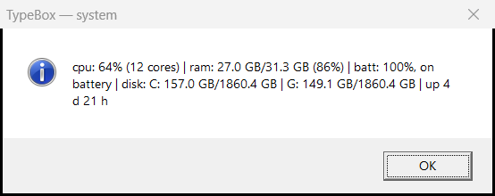
*`sys` answers the whole health readout in one line — copied to the clipboard,
and with `[Sysmon] Popup=1` even in a MessageBox. The tenth plugin, `sysmon.dll`,
is here — gallery #8.*

### System monitor — plugin gallery #8 (ROADMAP #7)

- ✅ **`cpu`** — real utilisation, not a lie: the percent is the **delta of two
  `GetSystemTimes` snapshots** taken by the plugin's own message-only window
  (`[Sysmon] SampleMs`, default 2 s). The very first call before the first tick
  answers `cpu: sampling (ask again in 2 s)` — there is no stale `0%`.

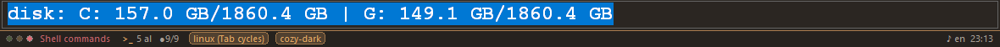
*The `disk` readout in the console — fixed drives with free/total GB, one line,
already on the way to the clipboard when you type `sys`.*
- ✅ **`ram`** — `ram: 9.8 GB/31.3 GB (63%)` via `GlobalMemoryStatusEx`;
  **`batt`** — state + percent via `GetSystemPowerStatus`, `batt: no battery
  detected` on desktops; **`disk`** — one line per fixed drive
  (`disk: C: 157.1 GB/1860.4 GB | G: …`), `[Sysmon] DiskMinGB` hides small drives.
- ✅ **`sys`** — all four plus uptime as one line, **auto-copied to the clipboard**
  (5× retry when the clipboard is busy — the console answer never depends on it);
  `[Sysmon] Popup=1` adds the classic MessageBox the gallery spec asked for,
  and the console keeps the answer either way (console-first doctrine).
- ✅ **EasyType** — `sy` + Tab completes `sys`; all five commands are plugin
  candidates with the usual per-plugin `[PluginState]` switch.
- ✅ `test-v0220.ps1`: 17 gates — every readout's exact shape, the **sampling →
  ready transition** on a fresh host with `SampleMs=8000`, `DiskMinGB` hiding,
  clipboard parity with the console line, the Popup=1 MessageBox (shown, closed
  with OK, answer still in the console) and the ET Tab path; a `cbprobe` health
  gate aborts the run on a system-locked clipboard instead of blaming the host.

## [0.21.0] - 2026-11-16

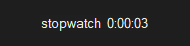
*`timer 25m pomodoro` and the console answers, the tray balloon fires when it is
due; `sw` starts a topmost mini label that ticks while you work. The ninth plugin,
`timer.dll`, is here — gallery #7.*

### Timers & stopwatch — plugin gallery #7 (ROADMAP #6)

- ✅ **`timer <dur> [label]`** — countdowns from the console: `timer 5m tea`,
  `timer 90` (plain seconds), `timer 1h30m` (mixed `s`/`m`/`h` runs). When one is due
  a **tray balloon** ("tea - time!") + beep fires and the console flashes; up to
  `[Timer] Max` (8) run at once, each keeping its own slot and label.
- ✅ **`timer` / `timer list`** — a one-line inventory with time left per entry
  (`timer: 24:58 (pomodoro), 4:59 (tea) left`); **`timer stop [label]`** cancels the
  matching timer or, with no label, the soonest one. Unparseable duration answers
  `timer: use 90, 5m, 1h30m, 90s`.
- ✅ **`sw` / `sw reset`** — stopwatch: start / report (`stopwatch: 0:00:04`) / stop,
  reset zeroes it. While running it shows a **topmost mini label**
  (`stopwatch 0:00:03`) you can keep beside any window (`[Timer] MiniWindow=0` to
  hide, `Sound=0` for silent balloons). All timing lives on the plugin's own
  message-only window; `Unload` kills timers, window and tray icon — no ghost after `/reread`.
- ✅ **EasyType** — `tim` completes `timer 5m/10m/25m/stop/list`, `sw` completes
  `sw`/`sw reset`; the plugin registers with the host's per-plugin `[PluginState]`
  switches like the other eight.
- ✅ `test-v0210.ps1`: 21 gates — lifecycle, cap at `Max=2`, soonest-stop, a **real
  2-second due-fire** (the tick loop must clear the slot), stopwatch report format,
  mini-window create/destroy asserted through the host process window list, and the
  EasyType Tab path.

## [0.20.0] - 2026-11-16

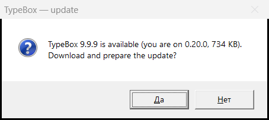
*Type `/update` and TypeBox asks the release API — the one and only place the
host ever touches the network, and only because you typed it. Newer version?
Download → **SHA-256 verified against the published digest** → staged →
"Restart and install?". Your `TypeBox.ini` is never touched by the installer.*

### `/update` — release check & install helper (RI3 #298, user request)

- ✅ **`/update`** — queries the GitHub Releases API once, compares `tag_name` with the
  running version (numeric, `v`-prefix tolerant), and offers the update as plain dialogs:
  download the release zip to `%TEMP%\TypeBox-update\`, verify its **SHA-256 against the
  digest published with the release** (a mismatch cancels outright — no "install anyway"
  on a broken digest; a release without a published digest asks you explicitly), unpack
  to a staging folder and prepare `install.bat`.
- ✅ **Automated install** — `[Update] AutoRun=1` (default): after verification the
  console asks "Restart TypeBox and install now?"; **Yes** and the host exits, the helper
  waits for the process to vanish, mirrors the staged tree over the app folder and
  relaunches TypeBox — the running exe never replaces itself, and **`.ini` files are
  excluded from the copy** (settings are the user's). `AutoRun=0` just stages the files
  and points at the folder.
- ✅ **Offline-first holds** — no background traffic: nothing phones home unless `/update`
  is typed; the opt-in `[Update] CheckOnStart=1` adds one silent startup check that only
  surfaces a tray balloon. `[Update] ApiUrl` mirrors the check (plain `http://` accepted
  only for loopback); the latest known tag + check time are cached and shown when the
  network is unavailable. Every step is logged (`/update: … available / digest verified /
  staged / installing via install.bat`).
- ✅ `test-v0200.ps1`: 11 gates against a fake localhost Releases API — ask dialog + version
  compare, sha256-verified staging, **digest-mismatch cancellation** (nothing staged),
  up-to-date path, offline path with cache display, missing-digest explicit-warning gate,
  `/help` advertises `/update`, and a real **AutoRun E2E**: host exits, exe is replaced,
  new instance runs, user INI provably untouched.

## [0.19.1] - 2026-11-16

*Regression fix for the user report "пропал вызов настроек": the v0.19.0 drag
handle turned the whole status strip into `HTCAPTION`, and `WM_NCHITTEST` cannot
tell which mouse button is down - so a right-click on the strip never became
`WM_CONTEXTMENU` and the console menu (Settings/Aliases/Plugins/…) did not open
there. With the default `Height=40` that dead zone was half of the console.*

- 🖱️ **Right-click on the status strip opens the console menu again** - the strip
  is claimed as a drag handle only while the **left** button is down
  (`GetAsyncKeyState(VK_RBUTTON)` guard); a right press falls through to the
  ordinary client-area path, and a defensive `WM_NCRBUTTONUP/HTCAPTION` handler
  opens the menu at the cursor even if the hit-test races.
- 🧪 Two new gates in `test-v0190.ps1`: real-mouse `SendInput` right-clicks over
  the edit line **and** the status strip must each raise the popup menu
  (`d7_rclick_edit_menu`, `d8_rclick_strip_menu`) - message-posting probes could
  not see this class of bug, so the suite now clicks for real.
- ✋ Drag behavior is unchanged: left-press on the strip moves the window,
  the spot survives hide/show, restart returns to the INI position.

## [0.19.0] - 2026-11-16

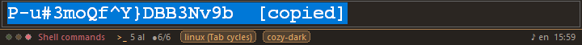
*Type `pw 20 s` and a cryptographically random password lands in the console
and on the clipboard - `pwgen.dll`, the eighth plugin, is here: `pw [len] [count] [flags]`
with `n` digits-only, `s` symbols, `p` pronounceable, `[Pwgen] Len/Symbols/Popup`
defaults, rejection-sampled `CryptGenRandom` (no modulo bias, never a silent weak fallback).*

### Third plugin wave + grab-and-drag

- 🔑 **pwgen plugin** (`Plugins\pwgen.dll`, gallery #9) - `pw 16`, `pw 20 s`,
  `pw 16 3` for three candidates (first copied): crypto-random passwords straight
  into the console with a `[copied]` tail; `[Pwgen] Len=16`, `[Pwgen] Symbols`,
  `[Pwgen] Popup=1` for the old-school MessageBox.
- 📊 **taskman 1.1 - `top`** - live CPU ranking from two `GetProcessTimes`
  samples 300 ms apart: `top`, `top 5`, `top chrome`; no psapi, no admin,
  console rows (`top: chrome.exe 12.4% (1234), …`).
- 🔁 **taskman 1.1 - `restart`** - `restart notepad` / `restart 1234`:
  image path via `QueryFullProcessImageNameW`, terminate, wait, relaunch through
  the shell - the app comes back on its own.
- 📌 **cliphist 1.1 - pin** - `clip pin 2` / `clip unpin 2`: a `*`-marked entry
  rides at the top of the list and survives trimming **and** `Persist` reloads.
- 🎯 **cliphist 1.1 - paste at caret** - `clip paste 1` hides the console,
  waits for the keystroke to land somewhere sane and types Ctrl+V where your
  caret is; `[Clipboard] PasteOnSelect=1` makes plain `clip <n>` do it too.
- ✋ **Drag the console by its status strip** - press on the 20 px strip and the
  window follows the mouse through the standard Windows move loop (multi-monitor
  fine); the spot is remembered for the session, and **every restart returns the
  console to its INI home position** - `[Show] DragMove` (on by default).
- 🧪 `test-v0190.ps1`: 38 gates - pwgen grammar incl. length/flag validation,
  `top` fuel detection against a real CPU burner, restart kill+relaunch pid
  churn, pin survival under `Max=4` trim pressure, paste-at-caret clipboard
  proof, and hit-test/position gates for the drag handle.

## [0.18.0] - 2026-11-16

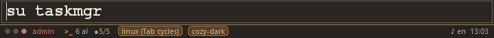
*Type `su taskmgr` and the console already knows: the status strip lights the
**admin** chip before Enter, and Enter really raises UAC — Task Manager opens
elevated. `su`, `/su` and `sudo` all work, and the prefix works in front of
everything TypeBox runs: aliases, `Scripts\` scripts, files, own-PATH programs
and shell lines.*

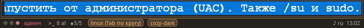
*Bare `su` launches nothing — the console answers with the usage hint
(localized in 17 languages).*

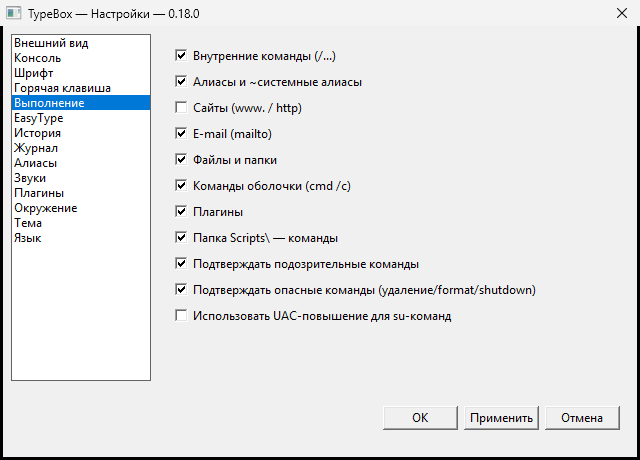
*The Execution page grew the third switch: **Use UAC elevation for su
commands** (`[Security] Elevate`) — the headless-automation kill-switch.*

### Added
- ⚡ **Run as administrator** (RI #81): `su <line>`, `/su <line>`, `sudo <line>`
  strip the prefix, classify the rest through the **normal chain** (internal →
  alias → plugin → script → file → PATH → shell) and perform the final
  `ShellExecuteEx`/`ShellExecute` with the **runas** verb — so aliases,
  `Scripts\` scripts, plain files, own-PATH programs and shell catch-all lines
  can all be elevated. URLs/e-mails/quicklinks stay at user level (runas on a
  mailto handler is meaningless). While you type, the traffic-light chip reads
  **admin**. Bare `su` shows a console usage hint. Cancelling UAC fails only
  that launch (`GetLastError=1223`); the host never blocks or dies.
- 🔐 `[Security] Elevate` (default 1, checkbox on the Execution page): `0` runs
  su-prefixed lines normally — the documented automation/CI switch, in the same
  spirit as the plugin `Popup=0` keys. Every elevation is logged
  (`elevate: <line>`).

### Under the hood
- `SuSplit()` + one-shot `g_elevateNext` in `Submit` (history keeps the typed
  line re-runnable; `Usage.dat` records the real command word, never `su`);
  verb swap at the six process-spawning sites of `RunLine`; `ClassifyAnchor`
  classifies the stripped line and overrides the chip label.
- i18n: 3 new keys (`so_admin`, `su_hint`, `se_elevate`) in 17 languages;
  `--check-i18n` now also dumps them, so CI verifies the su strings in every
  language pack.

### Verified
- `test-v0180` **20/20**: all three prefixes actually run the target (marker
  file) with `Elevate=0` and log the elevation decision; bare-`su` hint stays
  on screen; `Usage.dat` gains `hex`/`sutest` but never `su`; plugins receive
  the stripped line (`sudo hex 16` → `10`); `su del …` still fires the danger
  tripwire on the stripped command; the plain line without the prefix never
  logs an elevation. On the real UAC path all three prefixes were confirmed to
  raise `consent.exe` before launch.
- Full regression suite green: v0170 · v0160 · v0150 · v0140 · v0130 · v0120 ·
  v0110 · v0100 · v091 · v090.
- `--check-i18n` + `--test-settings` gates pass; downloaded release re-run
  before publishing.

## [0.17.0] - 2026-11-16

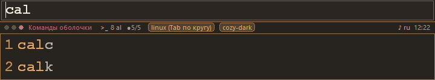
*Type `cal` and the drop-down no longer asks which one you meant last time — it
**knows**: `calc` (run 5× today) sits above `calk` (1×). The ranking comes from
`Usage.dat` next to the exe (`word · count · last-used`), delete the file to
start over, `[Type] FrecencyRanking=0` to switch it off.*

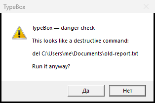
**Danger confirm** (v0.16 guard UI, new tripwire): `del`, `erase`, `rd`,
`format`, `diskpart`, `shutdown`, `reg delete`, `net user`, `vssadmin delete`,
`cipher /w`, `rm -r`, `dd if=`, `Remove-Item -Recurse -Force` … now stop and ask
before anything runs — token-based, so a path like `C:\del\report.pdf` stays
quiet. It fires on the **shell catch-all, script arguments and alias expansions**
an `alias → del …` chain is still a wiper. One key: `[Security] ConfirmDanger`.

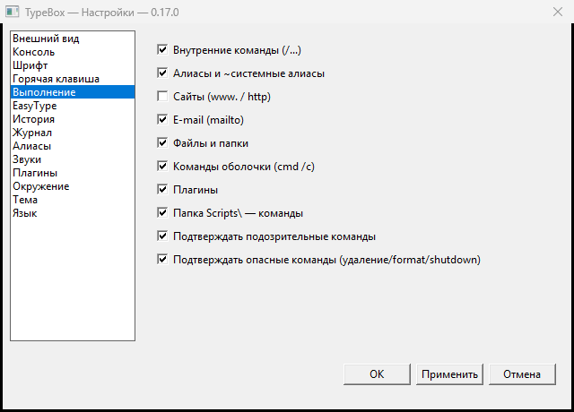
*Both tripwires plus the Scripts toggle live on the Execution page; the EasyType
page grew the FrecencyRanking switch.*

### Added
- 🏆 **Frecency ranking** (RI #75): every executed command line records its first
  word into `Usage.dat` (`word\tcount\tunix`); drop-down ties are won by
  frequently-used commands (count 3× per use, capped, +2 if used in the last
  24 h, total boost ≤17 so real match quality always dominates). Works in fuzzy
  and prefix modes; `[Type] FrecencyRanking` (default 1), checkbox on the
  EasyType page, startup logs `usage: N commands ranked`.
- 🗂️ **`TypeBox.local.ini`** (RI #76): an optional file next to `TypeBox.ini`
  whose keys win over the main config — keep the portable/team `TypeBox.ini` on
  a roaming folder and your personal position/theme/language locally. The
  settings dialog still writes the shared file; startup logs `local config: on`.
- 🛡️ **Danger-confirm** (RI #77): destructive-command tripwire with YESNO dialog
  reusing the v0.16 safe-Run UX (`[Security] ConfirmDanger`, default 1). Every
  decision is logged (`security: blocked/confirmed dangerous command`).
- 🔌 **winlist — window switcher** (gallery #6) ships in the zip, so it now
  carries **7 plugins**: `win notepad` raises (or flashes) the window,
  `win <n>` picks from the last filter, `win` lists. `[Winlist] AltTrick/Titles`,
  console-first, zero dialogs.

### Under the hood
- `UsageRec/LoadUsage/SaveUsage/RecordUsage/FrecencyBoost` after the history
  section; `DdUpdate` adds the boost in `add()` and `stable_sort` now also runs
  in prefix mode. `DdSyncTitle` exposes the top row for tests.
- `g_localIni` consulted first in `ReadIniStr/ReadIniInt`; plugins still read
  `TypeBox.ini` directly (documented).
- `LooksDangerous()` token scanner + shared `ConfirmDangerLine()` hooked at the
  alias expansion, script-args and shell stages.
- i18n: 2 new keys (`se_danger`, `ty_frecency`) in 17 languages.

### Verified
- `test-v0170` **26/26**: usage file format, tie-swap proves ranking
  (`calk` on top → run `calc` 3× → `calc` on top), danger dialog blocks (No) /
  runs (Yes) / stays quiet on `dir`, alias expansion covered, local-ini beats
  main ini (`Language=ru` override + `local config: on`), winlist activate/no-hit/
  completion rows, guard + scripts + cliphist + units regressions.
- Full regression suite green on the 0.17 host: v0160 26/26 · v0150 21/21 ·
  v0140 18/18 · v0130 11/11 · v0120 9/9 · v0110 12/12 · v0100 13/13 ·
  v091 11/11 · v090 15/15.
- `--check-i18n` + `--test-settings` gates pass; downloaded release re-run
  before publishing.

## [0.16.0] - 2026-11-16

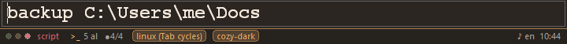
*Type `backup C:\Users\me\Docs` and the console already knows it is
`Scripts\backup.bat` — the status strip lights the yellow **script** chip before
Enter. Any `.bat/.cmd/.ps1/.py/.vbs` dropped into the portable `Scripts\` folder
becomes a command by its file name; arguments pass straight through.*

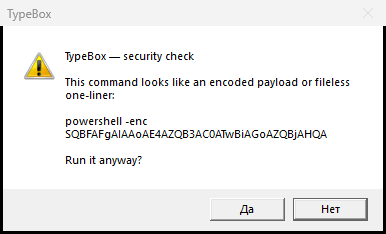
**The only safe Run box.** Encoded one-liners — `powershell -enc …`, base64 blobs,
`certutil`/`bitsadmin`/`mshta`, curl-pipe-shell — now stop and ask before the shell
executes them (the ClickFix paste-into-Run attack class). **No** = nothing runs,
and the decision is logged. Switch it off with `[Security] ConfirmSuspicious=0`.

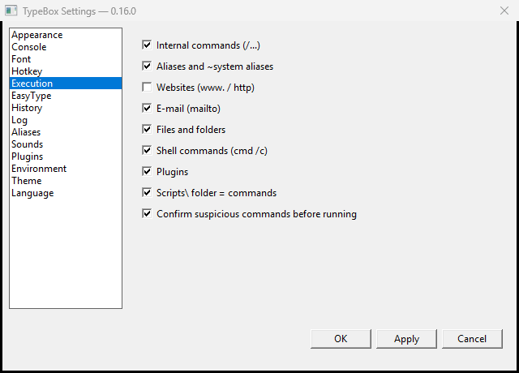
*Both new switches live on the Execution page: Scripts folder + suspicious-command
confirmation.*

### Added
- 📜 **Scripts folder auto-registration** (RI2 #159): every script in the portable
  `Scripts\` directory next to the exe is a command by its file name.
  `hello.bat` → type `hello world`; launcher picks the right host
  (`cmd /c` · `powershell -NoProfile -ExecutionPolicy Bypass -File` · `py` ·
  WScript association), arguments pass through. Traffic light shows a yellow
  **script** chip; startup logs `scripts: N registered`; `/reread` and Apply re-scan live.
- 🛡️ **Safe Run box — payload guard** (RI2 #168): before the shell catch-all (and
  before script arguments) runs a line that looks like an encoded payload or fileless
  one-liner, a confirmation dialog shows exactly what would run.
  ~30 signatures (`-enc`, `FromBase64String`, `DownloadString`, `certutil -`,
  `bitsadmin`, `mshta http`, `regsvr32 /i:`, `| sh`, `iex`, `mimikatz`, …) plus an
  ≥80-char base64-blob heuristic. One INI key: `[Security] ConfirmSuspicious` (default 1).
- 🔌 **Two more plugins from the gallery ship in the zip** —
  **cliphist** (`clip` list · `clip 3` re-copy · `clip clear`; RAM watcher on
  `CF_UNICODETEXT`, `[Clipboard] Max/PollMs/RowChars/Popup/Persist/Balloons`) and
  **taskman** (`task chrome` list · `kill notepad` with one confirmation popup,
  `[Taskman] Confirm=0` for automation). Both console-first: they answer inside the
  TypeBox console and never block the host. The zip now ships **6 plugins**.

### Fixed / hardened
- Host never dies to a suspicious line twice: guard covers both the shell stage and
  script arguments (`script started` only after an explicit Yes).

### Under the hood
- `ScriptCmd {name, path, ext}` model + `LoadScripts()`/`FindScript()`; dispatch stage 4c
  sits between file/URL resolution and the shell catch-all.
- `LooksSuspicious()` — lowercase signature scan + rolling base64-run detector.
- i18n: 3 new keys (`ex_scripts`, `se_suspicious`, `so_script`) in 17 languages.

### Verified
- `test-v0160` **26/26**: script registration + arg pass-through, guard dialog appears /
  No blocks / Yes runs, safe lines never prompt, guard-off honors INI; cliphist
  newest/second/list/clear/empty-answers + ET rows; taskman list/no-hit/ET + confirm
  dialog → cancel keeps host alive; units still consumes.
- ABI-probed both new DLLs against the host harness (`TInfo` 56 B / `TExec` 24 B,
  all 8 exports, real `TerminateProcess` of spawned test processes).
- Full regression suite green: v0150 21/21, v0140 18/18, v0130 11/11, v0120 9/9,
  v0110 12/12, v0100 13/13, v091 11/11, v090 15/15.
- `--check-i18n` + `--test-settings` gates pass; downloaded release re-run before publishing.

## [0.15.0] - 2026-11-16

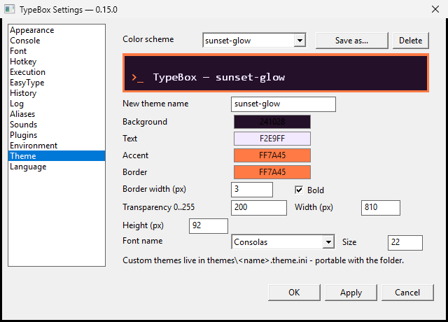
*The Theme page is now a **theme studio**: color scheme combo (built-ins + your own), four
click-to-pick color patches (native color dialog), border thickness, transparency, console
size, font family/size/bold — and a live preview that paints your draft as you edit.*

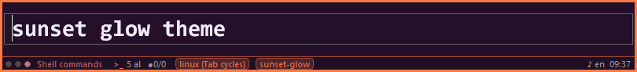
*The console wearing a custom theme: deep-purple background, lavender text, 3 px orange
frame, and the theme name in the status-strip chip.*

### Added
- 🎨 **Create your own themes** (the user asked: «создание своих тем, настройка цвета,
  шрифтов, прозрачности, ширины, толщины»): the Theme page grew a studio —
  - **colors** — Background / Text / Accent / Border patches open the native
    `ChooseColorW` dialog; each shows its hex; the preview card repaints live.
  - **border thickness** — 0..24 px frame drawn around the console (custom themes only;
    built-ins stay frameless). Border color defaults to the accent when unset.
  - **transparency, console width/height, font family/size/bold** — editable right on the
    Theme page; picking a theme pushes its look into the ordinary `[Show]`/`[Font]` keys.
  - **Save as… / Delete** — a theme is a portable `themes\<name>.theme.ini` next to the exe:
    `[Theme] Bg Fg Accent Border BorderWidth Alpha FontName FontSize FontBold Width Height`
    (colors as `RRGGBB`). Copy the `themes\` folder → your looks travel with TypeBox.
  - The combo lists built-ins + customs; built-ins cannot be deleted or shadowed
    (saving as `cozy-dark` becomes `cozy-dark-copy`); deleting a custom is instant
    (the file is re-creatable with one click).
- 🧵 `/reread` now reloads `themes\` too — edit a `.theme.ini` in any editor, hit `/reread`,
  the console re-skins without a restart.

### Under the hood
- `Theme` grew from 4 fields to 12 (name/bg/fg/accent + border/borderW/alpha/font/geometry,
  sentinels `-1`/`CLR_NONE`/`""` = unset); `ApplyThemeVisual` also computes the effective
  frame; the edit control is inset by the border width in `WM_SIZE`; frame is painted in
  `WM_PAINT`/`WM_PRINTCLIENT`/`WM_ERASEBKGND` (screenshots capture it).
- Explicit `[Color] ConsoleBG/ConsoleFG` still win over theme colors (unchanged rule).
- New localized strings (`th_bg`..`th_portnote`) in 17 languages with English fallback.

### Verified
- `test-v0150` **23/23**: Save-as writes the right hex colors, built-in shadowing refused,
  combo lists customs, picking a custom pushes Alpha/Width/Height/Font into `[Show]`/`[Font]`,
  `[Theme] Name` persists across restart, `/reread` survives, Delete removes the file,
  built-in delete is a no-op.
- Full regression suite green: v0140 20/20, v0130 12/12, v0120, v0110, v0100, v091,
  v090 15/15 (language combo re-indexed for the two new studio combos).
- `--check-i18n` + `--test-settings` gates pass on the built exe.

## [0.14.0] - 2026-11-15

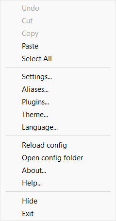
*Right-click the console — just like the original TypeAndRun. Edit operations up top
(gray = not applicable), then Settings/Aliases/Plugins/Theme/Language, config reload, About,
Hide, Exit. Fully localized in all 20 languages (Russian menu below).*

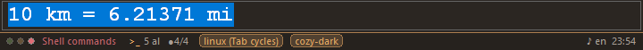
*`conv 10 km mi` — the first gallery plugin answers right inside the console: the result
stays on screen, selected, ready to Ctrl+C (the console no longer vanishes on plugin answers).*

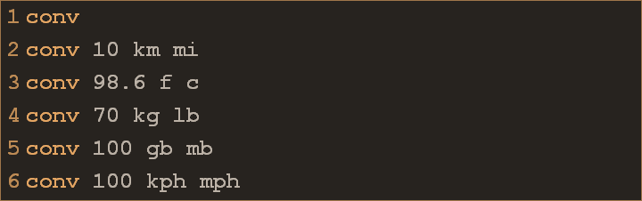
*Typed `conv` and the units plugin feeds the drop-down its own example rows — Tab accepts.*

### Added
- 🔌 **Three real plugins** from [docs/PLUGIN_GALLERY.md](PLUGIN_GALLERY.md) — the first wave
  of the Top-5, zero dependencies, they ship in the zip's `Plugins\` folder:
  - **units** — `conv 10 km mi`, `conv 98.6 f c`, `conv 100 gb mb` (length/mass/speed/data/time
    + temperature), and base converter `hex 255` → `FF`, `bin 0xFF`, `dec 0xFF`, `oct 777`.
  - **codec** — `b64enc/b64dec`, `urlenc/urldec`, `hexenc/hexdec`; invalid input answers with
    a clear error row instead of garbage.
  - **vol** — `vol +` / `vol -` / `vol mute` / `vol 3` via simulated media keys.
  All three propose example rows in the drop-down (plugin `GetCountET`), answer in the console
  AND put the raw value on the clipboard.
- 🖱️ **Console context menu** (the user asked; the original TypeAndRun had one): right-click
  the console → Undo/Cut/Copy/Paste/Select All (state-aware) · Settings/Aliases/Plugins/
  Theme/Language · Reload config · Open config folder · About · Help · Hide · Exit.
  Localized in 20 languages via a new `kCtxItems` table in `src/i18n.h`.
- 📌 **Plugin results now stay on screen**: Enter on a plugin line keeps the console open
  with the answer selected (it used to be cleared+hidden by `Submit`, so plugin output was
  only ever visible as a MessageBox/clipboard). Esc/hotkey still hide.
- 📝 Host logs each consumed line: `plugin: units handled: conv 10 km mi` — debuggable
  plugin routing at last.

### Config
- `[Units] Popup=0|1`, `CopyResult=0|1` · `[Codec] Popup`, `CopyResult` · `[Vol] Step`, `Beeps`
  (see [CONFIG.md](CONFIG.md)).

### Verified
- `test-v0140` **20/20**: 4 plugins discovered+enabled, conv/hex/b64enc/hexdec/vol verified via
  BOTH the edit box and the clipboard, plugin-handled log lines, units ET rows, and the new
  context menu (opens, Settings item opens the dialog, Paste item pastes, Hide item hides).
- Regressions stay green: v0130 12/12, v0120 11/11, v0110 13/13, v0100 14/14, v091 12/12,
  v090 16/16.

## [0.13.1] - 2026-11-15

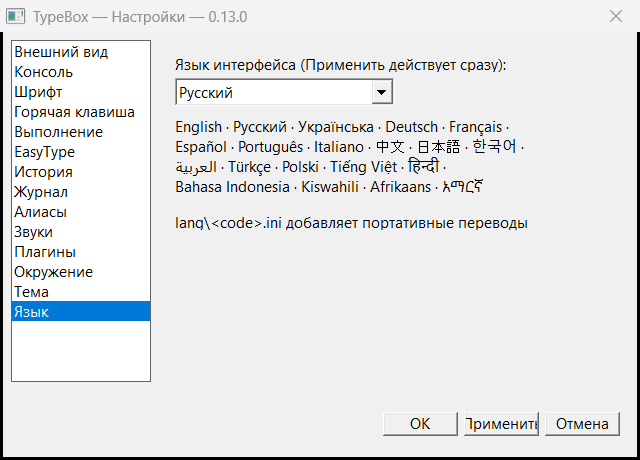
*Russian (and every non-ASCII language) now renders correctly in the **released** exe —
this screenshot is taken from the downloaded CI build, not a local one.*

### Fixed
- 🐛 **Non-ASCII strings were mojibake in CI builds** (`автор` instead of `Автор`).
  MSVC compiled `src/i18n.h` (all 20 language packs) in the system ANSI codepage because
  CMake never passed `/utf-8`. Local MinGW builds were fine, which is why every ASCII-only
  gate stayed green while the shipped exe garbled 19 of 20 languages.
- CMake now passes `/utf-8` to MSVC for the host and the example plugin.

### Verified
- New CI step **i18n render gate**: launches the MSVC build with `Language=ru`, opens the
  settings dialog and enumerates window text — the build fails unless `Применить` and
  `Внешний вид` actually render. This class of bug can no longer ship.
- `test-v0130` re-run 12/12 on this build.

## [0.13.0] - 2026-11-15

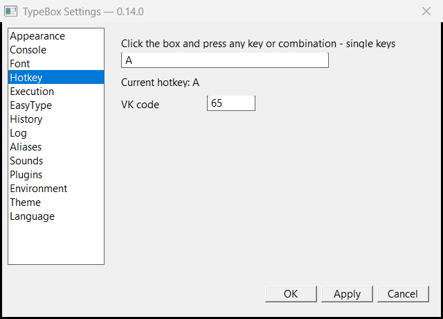
*A single letter is a hotkey now: press **A**, it lands in the box as `A` (VK 65) — no modifier
minimum, no forbidden keys, no rejected combinations.*

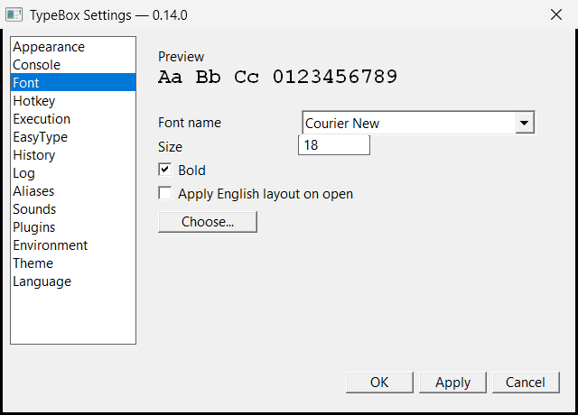
*Font page: the name is now a dropdown of installed families and the preview card repaints
the moment you pick — no more typing font names by hand.*

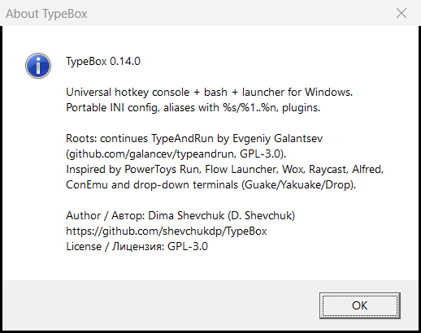
*About finally says who made what: roots (TypeAndRun / Evgeniy Galantsev), inspirations,
and the maintainer — Dima Shevchuk.*

### Added
- 🗝️ **Unrestricted hotkeys** — any key works: single keys (`Q`), media keys (`VolUp`,
  `PlayPause`), `Esc` itself, F13–F24, numpad, OEM symbols. When `RegisterHotKey` refuses
  (single key, another app owns the combo, unsupported extended key) TypeBox falls back to a
  **low-level keyboard hook** with exact-modifier matching; the key is consumed while the
  console is hidden and passed through while it is open, so a single-letter hotkey never
  eats your typing. `MOD_NOREPEAT` kills auto-repeat on the RegisterHotKey path.
- 🔤 **Font picker** — the Font page lists every installed family (vertical CJK variants
  filtered); the custom INI value still round-trips if it is missing from the list.
- 👀 **Live previews** — theme combo and font combo repaint instantly
  (`CBN_SELCHANGE`), no Apply-click needed to try a scheme out.
- ℹ️ **About box** now carries author/maintainer (Dima Shevchuk), repository URL and license
  alongside the existing roots & inspiration text.
- 🏷️ Human-readable key names everywhere the hotkey is shown: `Esc`, `Enter`, `Tab`, `PrtSc`,
  `Mute`, `VolUp`, `NextTrack`, `Num7`, `F19`, `WebFav`, `;`, `+`, `Space`… (was `VK165`).

### Fixed
- `PgUp`/`PgDn` labels were swapped in the capture box.
- Esc no longer "cancels" capture — it is an assignable key like any other (dialog Cancel
  discards drafts; capture never applies anything on its own).

### Verified
- `test-v0130` (12 checks): RegisterHotKey mode log, Esc assignable in the capture box,
  plain-**Q** single key shows the box via the hook and stays typable while open, edge guard
  re-fires after key-up, hijacked Ctrl+Shift+F2 falls back to the hook and the chord still
  toggles, plain Q ignored in chord mode (exact mods), `--test-settings` OK.
- Regressions stay green: `test-v0120` 11/11, `test-v0110` 13/13, `test-v0100` 14/14,
  `test-v091` 12/12, `test-v090` 16/16 (combo indices shifted +1 by the font picker).

## [0.12.0] - 2026-11-15

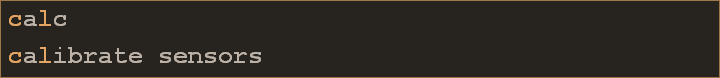
*Rows now carry **1…9** on the left — press **Alt+1**…Alt+9** to run a row instantly; the typed
fuzzy hits still glow in the accent color.*

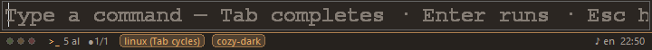
*An empty console teaches itself: the cue banner spells out the four keys, and the three lamps
stay visible even when unlit.*

### Added
- ⌨️ **Alt+1…9 quick-select** — numbered rows in the drop-down, Alt+digit runs that row
  (Flow/Wox/Listary muscle memory); Home/End jump to first/last row.
- 🔎 **Web-search quicklinks** — `[WebSearch] wb=https://…%s`: keyword + query opens the default
  browser (`so hello world` → logged URL, EXC_URL history, amber anchor preview). Built-in
  `g`/`yt`/`gh`, user rows override/add; `[WebSearch] Enable=0` disables.
- 📜 **Drop-down scrolling** — more candidates than `[DropDown] Lines`: **↑/↓** and the mouse
  wheel scroll the list now (rows past the cap used to be unreachable).
- 🖱️ **Hover-execute guard** — mouse hover highlights a row but **Enter** still runs the line you
  typed; only keyboard-selected rows (or a click) run.
- 💡 **Cue banner** in the empty console ("Type a command — Tab completes · Enter runs · Esc
  hides", localized) — hand-drawn so it survives screenshots and the .rc-less build.

### Improved
- 🎨 **Contrast guard** — status-strip counts, chips and the clock auto-raise their color mix
  until ≥ 4.5:1 against the theme background (light themes were illegible at 1.85:1).
- 📏 Console edit height follows the font (`tmHeight+6`) — 18 pt no longer clips; AutoHide timer
  resets while typing; unlit traffic-light lamps are actually visible (32% fill + ring);
  tray tooltip now shows the hotkey (`TypeBox 0.12.0 — Ctrl+Shift+F2`).
- 🧹 calc plugin `GetInfo` de-mojibaked (ASCII description in the Plugins page).

### Verified
- `test-v0120` (11 checks): quicklinks count/candidate/URL log + `[Exec] WWW=0` block, hover
  guard keeps the typed line, Alt+1 runs the top row, 12-row list scrolls to `|9|2`,
  `--test-settings` OK. `test-v0110` 13/13, `test-v0100` 14/14, `test-v091` 12/12, `test-v090`
  17/17 stay green.

## [0.11.0] - 2026-11-15

*`[Type] Fuzzy`: typed **“cl”** — no row starts with it, yet `calc` and `calibrate sensors`
surface because **c**…**l** appear in order; the hit characters glow in the accent color and the
best score sits on top.*

- 🎯 **Fuzzy matching** — on by default in Tab-completion and the drop-down. Subsequence
  scoring: straight prefix `+10`, word-start hit `+8`, consecutive run `+5`, gap `−1`, shorter
  rows preferred, ties keep source order.
- 🎨 Matched characters are accented per row (non-contiguous hits included); the old contiguous
  prefix highlight stays in prefix mode.
- ⚙️ `[Type] Fuzzy=1` in the portable INI (**0** = strict TypeAndRun prefix mode), *Fuzzy
  matching* checkbox on **Settings → EasyType**, startup log `fuzzy: on`.
- ✔ `test-v0110` 13/13: `cl` lists `calc`+`calibrate sensors`, ↓+Tab accepts the top row,
  `Fuzzy=0` completes nothing for `cl` while `ca` still works; `test-v0100` 14/14, `test-v091`
  12/12, `test-v090` 17/17 stay green.

## [0.10.0] - 2026-11-15

### Added
- **Drop-down suggestions** — TypeAndRun's `frmTypeDropDown` reborn: a themed suggestion list
  snaps under the console (flips above at the screen edge) while you type. Rows are the ET
  candidates for the word at the caret — aliases, `~sysaliases`, known `/commands`, plugin
  commands and history — or, on an empty line, the history itself (`ShowHistoryOnEmpty`).
  - Keyboard: **↑/↓** select, **Tab** accepts the row into the line, **Enter** runs the selected
    row, the first **Esc** closes just the list (the second hides the console).
  - Mouse: hover highlights, click accepts and runs.
  - The typed prefix is painted in the theme accent on every row; the whole list is drawn in the
    `[Theme]` colors — the old per-popup `DropDownColor/DropDownText/BorderSize` trio is
    replaced by the scheme.
  - `[DropDown] Enable=1 · Lines=8 · ShowHistoryOnEmpty=1` in the portable INI; the **EasyType**
    settings page gained *Show suggestions drop-down*, *Visible rows*, *History when the line is
    empty*. Startup log: `dropdown: on (8 rows)`.
- Status strip/anchors unaffected: the traffic light keeps classifying while the list is open.

### Fixed
- **Esc is handled once, in the edit** — the message loop no longer hijacks it first, so with a
  list open Esc closes the list instead of hiding the whole console.

### Verified
- `test-v0100` (14 checks): startup `dropdown:` log, list for `ca` shows the alias/plugin match
  (deduped), ↓ selects, Tab accepts (`maintext=calc`), Enter runs and fills `History.dat`,
  reopen shows history, Esc closes list then hides console, `Enable=0` disables everything,
  EasyType page carries the new controls, `--test-settings` OK. `test-v090` (17) and
  `test-v091` (12) stay green.

## [0.9.1] - 2026-11-15

### Added
- **Cozy themes** — seven warm presets paint the console, the status strip and the
  tray badge as one: `cozy-dark · paper-light · midnight-blue · nord-frost ·
  solarized-dark · solarized-light · forest-night`. Pick it on the new **Theme**
  settings page (live preview card) or via `[Theme] Name=`; explicit
  `[Color] ConsoleBG/ConsoleFG` always win. Apply re-skins everything live
  (log: `theme: nord-frost`).
- **Cozy tray badge** — drawn with GDI (no resources): charcoal circle, rim in the
  theme accent, `>_` glyph; state dot: **idle** dim rim, **console shown** accent
  dot, **error since start** red dot (cleared on Apply). System-icon fallback if GDI
  ever fails.
- **Status strip** (bottom 20 px of the drop-down, self-drawn, follows the theme):
  mini `>_`, alias count, plugin dots `●2/3`, EasyType and theme chips, sound ♪,
  language code and a clock. Console default height 40 → 56.
- **Visual anchors — a traffic light next to what Enter will do** (re-classified on
  every keystroke): 🟢 green = your own (`alias`, `~sysalias`, known `/command`);
  🟡 amber = found outside (`PATH` program, file/folder, URL, mail, plugin command);
  🔴 red = catch-all/unknown (shell fallback, unknown `/cmd`, or the class is
  switched off in `[Exec]`). Each lamp lights with a localized label
  (Aliases / from PATH / shell commands / disabled by [Exec] …).

### Fixed
- Settings dialog buttons (OK/Apply/Cancel/Add/Update/Delete/Choose.../Clear
  history/Rescan/Unload all/About/Options/Add var…) now dispatch by **control id**,
  not by button text — before, they were dead in every non-English UI.

### Verified
- `test-v091` (12 checks): startup `theme:` log, Theme-page combo + Apply round-trip
  (`Name = forest-night`), Apply click in the **Russian** UI (id dispatch), explicit
  `[Color]` override survives, tray fallback path, `--test-settings` on the 14-page
  dialog. `test-v090` regression still 17/17. Traffic lights visually verified for
  alias (green), URL/PATH/plugin (amber), shell/unknown (red).

## [0.9.0] - 2026-11-15

### Added
- **Full UI localization — 20 languages, everywhere**: tray menu and balloon, help/about,
  the settings dialog (all 13 pages, buttons, labels) speak your language.
  - Compiled-in packs: **8 complete European** (en · ru · uk · de · fr · es · pt · it) and
    **12 core** (zh · ja · ko · ar · tr · pl · vi · hi · id · sw · af · am — anything missing
    falls back to English transparently).
  - `[UI] Language = auto | code` in the portable INI; `auto` detects the Windows UI language
    (`GetUserDefaultUILanguage`, user-locale fallback). New **Language** page in the settings
    dialog: pick from the list, Apply switches the UI immediately.
  - **Arabic is right-to-left**: the drop-down mirrors (`SetProcessDefaultLayout` +
    `WS_EX_LAYOUTRTL`), the console font auto-falls back to a script-capable face
    (Microsoft YaHei UI / Yu Gothic UI / Malgun Gothic / Segoe UI / Nirmala UI) when the
    default Courier New would not render CJK/Devanagari/Ge'ez.
  - **Portable community packs**: `lang\<code>.ini` (key=value, UTF-8/UTF-16, `;` comments)
    overrides any string on top of the compiled pack — no rebuild needed.
    Key names: [src/i18n.h](src/i18n.h) `kKeyNames`.

### Fixed
- Apply re-runs language + RTL layout live without a restart.

### Verified
- `test-v090` (17 checks): `Language=ru` → Russian page names via the settings listbox dump;
  `de` → Konsole/Sprache, no RTL; `ar` → `WS_EX_LAYOUTRTL` set, Arabic page names;
  Language-page combo + Apply round-trip (`Language=ru` in INI, log `language: ru`);
  `lang\ru.ini` override wins over the pack; `--test-settings` survives Arabic RTL.

## [0.8.0] - 2026-11-15

### Added
- **Own PATH & variables** — TypeBox's version of the Windows *Environment Variables*
  dialog (System Properties): `[Path]` folders and `[Variables]` in the portable INI.
  - `DirN = C:\tools` (or `Extra = a;b;c`, `%VARS%` / `%TYPEBOXDIR%` allowed):
    typed commands are looked up in your folders first — `mytool` launches
    `mytool.exe` from a `[Path]` folder directly, with the process handle kept for
    Shift+Enter; folders are also prepended to PATH so aliases, shell lines and every
    child program find your tools.
  - `[Variables] NAME = value` define `%NAME%` substitutions usable in aliases,
    sysaliases and typed text (they take precedence over real env vars).
  - Settings dialog gained an **Environment** page: multiline folder box + variable
    editor (list, name/value, Add/Update/Delete). `[Path]`/`[Variables]` sections are
    rewritten on OK/Apply; Cancel discards.
  - `/path` internal command shows the current folders and variables; startup log
    reports `own PATH: N folders, variables: M`.
- **Screenshots** — `docs/screenshots/` (console + every settings page) shown in the
  README and attached to releases.

### Fixed
- A missing program in an alias/sysalias popped the modal system "file not found"
  dialog, blocking the main thread — ShellExecuteEx now runs with
  `SEE_MASK_FLAG_NO_UI`; failures are only logged (`alias failed: ... GetLastError=`).

### Verified
- `test-v080`: bare-name launch from `[Path]` (`path started: tbtool`), alias resolved
  through the injected PATH (`alias started: bare`), `%TBTOOLDIR%` folder expansion,
  GUI folder/variable edits round-trip to INI, Cancel discards them, restart picks up
  the new folder (`own PATH: 1 folders, variables: 2`).

## [0.7.0] - 2026-11-15

### Added
- **Sounds page** in the settings dialog (TypeAndRun `fraSounds` parity): enable toggle
  plus all nine per-execution-type WAV fields (`ExecuteInternalSound`,
  `ExecuteAliasSound`, `ExecuteSysAliasSound`, `ExecuteURLSound`, `ExecuteEmailSound`,
  `ExecuteFileSound`, `ExecuteFolderSound`, `ExecutePluginSound`, `ExecuteShellSound`);
  paths are absolute or relative to the portable folder and are written back to `[Sounds]`.
- **Plugins page** (TypeAndRun `fraPlugins` parity, TypeBox-style per-plugin state):
  list of discovered plugins with info panel (name/version/description/author/copyright/
  homepage read live from the plugin's `GetInfo`), **Load on start** and **Save to history**
  checkboxes, and **Rescan / Unload all / About / Options** buttons (the last two call the
  plugin's own exports when present).
- **`[PluginState]` INI section** — my extension over TypeAndRun's Plugins.ini:
  `<dllname>_Load=0|1` skips Load()/command routing for a plugin,
  `<dllname>_SaveHistory=0|1` keeps its commands out of the history.
  Live-apply: disabling a plugin in the dialog unloads it immediately; the startup log
  now reports `N plugins, M enabled`.

### Fixed
- Page-local controls (alias editor buttons, Clear history, Choose font, new plugin
  buttons) never reached the dialog proc — page windows now forward `WM_COMMAND`
  to the settings window, so in-page buttons and list selections work.
- `PluginKey` embedded-NUL truncation made `[PluginState]` keys collapse to the dll
  name without the `_Load`/`_SaveHistory` suffix.

### Verified
- Harness (`btns`/`clickbtn`/`getcheck`) against a live dialog: plugin checkbox defaults,
  Load-off + OK → `calc_Load=0`/`calc_SaveHistory=1` in the INI, restart →
  `1 plugins, 0 enabled`, sounds toggle → `EnableSounds=0`, sound path keys written,
  Rescan → `plugins rescanned, 1 found`, Cancel discards a re-toggled checkbox.

## [0.6.0] - 2026-11-15

### Added
- **Settings dialog** (`/settings`, tray "Settings...") — the TypeAndRun GUI parity
  milestone: settings are now edited in a window, not only in the INI.
  Nine pages: **Appearance** (start/hide/tray/balloons/AutoHide/Priority) ·
  **Console** (size/position/centering/alpha/BG/FG colors) ·
  **Font** (name/size/bold + native *Choose font...* dialog + ApplyEnglish, live preview) ·
  **Hotkey** (click the box, press the combo — THotKey-style capture widget,
  VK display) · **Execution** toggles · **EasyType** (mode + completion sources) ·
  **History** (max, per-type save toggles, Clear history) ·
  **Log** (enabled/file/max KB/rewrite method/keep) ·
  **Aliases** (list + name/action/work-dir/window-state editor with Add/Update/Delete).
- **TypeAndRun save semantics**: the dialog edits a scratch copy —
  **Cancel discards**, OK/Apply write `TypeBox.ini` key-by-key
  (comments and unknown keys survive; `[Aliases]` is rewritten canonically) — then
  **`ApplySettings` applies live**: hotkey re-registration, font, geometry, alpha,
  process priority, tray, AutoHide timer, background brush. `[Coordinates]`
  remembers the dialog position (parity with TypeAndRun).
- `/config` opens the dialog on the Aliases page (TypeAndRun parity);
  `/openconfig` keeps the old "open TypeBox.ini" behavior; tray menu gained
  **Settings...**.
- CI **smoke gate** now also runs `TypeBox.exe --test-settings` — a build whose
  settings dialog cannot be created/pumped/closed never reaches a release.

### Verified
- Round-trip harness (posts real WM_KEYDOWN/WM_SETTEXT/BM_CLICK at the dialog):
  INI→GUI load (width, font, hotkey text, history max, log size),
  GUI→INI save (`Max=1234` after typing + OK), hotkey capture (F9 →
  `[HotKey] Key=120`), external INI edit + `/reread` reloads the dialog,
  **Cancel discards** (typed 999, file kept 77), `[SysAliases]`/comments survive
  the rewrite, `settings applied` in the portable log.

## [0.5.0] - 2026-11-15

### Added
- **System aliases (`[SysAliases]`)** — TypeAndRun-style `~name = action` commands
  with safe built-in defaults `~lock · ~logoff · ~sleep · ~screensave · ~reboot`;
  user section replaces the table; `%s`/`%1..%n` supported; Tab-completed
  (`[Type] UseSysAliasET`); logged on failure (`sysalias failed: ...`).
- **Ignores.ini (BadApp parity)** — portable file of process-name / window-class
  patterns (wildcards `*` `?`); while the foreground window matches, the hotkey
  keeps the console hidden.
- **Shift+Enter kills the last alias process** — `ShellExecuteExW`
  (`SEE_MASK_NOCLOSEPROCESS`) keeps the handle, `TerminateProcess` on demand;
  works for aliases and sys aliases; result visible in the log.
- **`[Show] Priority`** — process class of TypeBox itself:
  `idle · normal · high · realtime` (`SetPriorityClass`).
- **`[Font] ApplyEnglish`** — force US-English keyboard layout when the console
  opens (TypeAndRun parity, no more typing commands in the wrong layout).
- **`/sys` command** — RAM/CPU/uptime/battery snapshot to the portable log and a
  tray balloon (non-blocking, PowerToys-Run-style info line).
- `/checkconfig` now also reports sys aliases and Ignores counts.

### Verified
- End-to-end harness (C helper posts WM_HOTKEY / WM_KEYDOWN): hotkey toggle,
  Ignores suppression over the foreground app, sys alias launch, alias launch
  with handle tracking, Shift+Enter kill — all confirmed through the portable log
  (`alias started: cmd (handle ok)` → `Shift+Enter: killed alias process cmd`).

## [0.4.0] - 2026-11-15

### Added
- **Plugin host with TypeAndRun-compatible ABI** (`docs/PLUGIN_API.md`):
  `Load(HWND) / Unload / GetInfo / GetCount / GetString / GetCountET / GetStringET /
  RunString → TExec`, optional `GetPluginMenu / About / Options / FastConfig / HookKey`.
  ANSI (CP_ACP) strings for 1:1 compatibility with 2001–2004 plugins.
  Plugins are discovered from the portable `Plugins\` folder and `[Plugins]` ini entries;
  `/load` rescans at runtime, `/unload` deactivates them.
- **Execution chain consults plugins** (after aliases, before URL): the first plugin
  returning `TExec.run != 0` consumes the input; `con_text` is placed into the console
  with selection — exactly like TypeAndRun.
- **Plugin completion sources** for `Tab` (static `GetString` list + dynamic `GetCountET`).
- `[Exec] Plugins` toggle (default on).
- **`examples/plugin_calc/calc.c`** — calculator plugin (`calc 2+3*4`) in the original ABI,
  buildable with both MSVC and MinGW; doubles as a template for porting legacy
  `tar_math`-style plugins.
- **Portable error log with configurable size & rewrite method** — `[Log] Enabled /
  File / MaxSizeKB / Rewrite=rotate|truncate|timestamp|keep / Keep`; failed hotkeys,
  plugin load errors, failing aliases and import/export errors land there;
  open with `/log`.
- **`TypeBox.exe --version`** console flag + CI **smoke gate**: a build that cannot
  start, reports a wrong version, or fails to load the example plugin never reaches a release.
- **MSVC release is fully static** (`/MT`) — release zip needs no VC++ redistributable;
  MinGW build documented with `-static` (no libgcc/libstdc++ DLL dependencies).

### Fixed
- **Example `calc.dll` now exports the ABI under MSVC too** (`__declspec(dllexport)` via
  `CALC_BUILDING_DLL`) — the first published zip carried a host-invisible calc.dll
  (MSVC exports no symbols without dllexport; MinGW exported them implicitly).
  The host also tolerates legacy 32-bit `_Name` cdecl exports.

### Verified
- End-to-end ABI smoke test: host discovers a DLL in `Plugins\`, calls `Load`, routes a
  line through `RunString`, applies `TExec` — against MinGW g++ 13.2 (`-Wall -Wextra`, clean).
- Every published asset is downloaded and executed on a real machine
  (`--version` exit code, GUI liveness, startup log content).

## [0.3.0] - 2026-11-15

### Added
- **EasyType completion** (`[Type]`) — `Tab` completes the word at the caret from
  internal commands, aliases and history; repeated `Tab` cycles matches.
  Sources toggleable: `UseInternalET` / `UseAliasET` / `UseHistoryET`.
- **`/export <path>` and `/import <path>`** — one-command settings portability
  (import backs the current config up as `TypeBox.ini.bak` and live-reloads it).
- **`/undo`** command in addition to `Ctrl+Z`.
- **AutoHide** — `[Show] AutoHide=1`, `AutoHideValue=<seconds>` hides an idle console.
- **Console colors** — `[Color] ConsoleBG / ConsoleFG` (COLORREF integers).
- **Per-type history toggles** — `[History] Internal/Alias/WWW/EMail/Path/Plugins/Unknown`
  (TypeAndRun parity).

### Fixed
- Single `[History]` section in the sample config.

### Verified
- CI smoke gate additionally requires the example plugin to load through the ABI
  (`startup log: N plugins`, no "plugin load failed"/"ignored non-plugin dll").
- History candidate list rebuilds correctly when typing between `Tab` presses.

## [0.2.0] - 2026-11-15

First functional build. CI compiles with MSVC on every push; tagged releases ship a
portable zip with `TypeBox.exe` + `TypeBox.ini`.

### Added
- **CI/CD** — `.github/workflows/build.yml`: MSVC (Ninja) build on `windows-latest`,
  `VERSION`-vs-tag consistency check, artifact zip `TypeBox-<ver>-windows-x64.zip`,
  GitHub release on tag with binaries and roots/inspiration notes.
- `VERSION` file — single source of truth for the version; injected into the binary
  via CMake (`/about`, tray tooltip show it).
- **All 14 TypeAndRun internal commands** —
  `/about /checkconfig /config /exit /help /hide /homedir /inidir /inifiles /load
  /reread /settings /show /unload` (`/load`–`/unload` become functional with Phase 2 plugins).
- **Tray icon** with context menu (Show/Hide · Config · Exit) and startup balloon tip
  (`[Show] TrayIcon`, `BalloonTips`).
- **Transparency** — `[Show] Transparent=0..255` (layered window).
- **Font from INI** — `[Font] Name / Size / Bold`.
- **`[Exec]` toggles** — Internal / Aliases / WWW / EMail / Files / Shell now all honored.
- **Sounds** — `[Sounds] EnableSounds` + 9 per-execution-type sounds (internal, alias,
  sysalias, url, email, file, folder, plugin, shell), paths relative to the portable
  `Sounds\` folder (TypeAndRun parity).
- **Undo** — `[Undo] UseUndo`, `Ctrl+Z` restores the last executed command.
- **Persistent history** — saved to portable `History.dat` next to the exe (UTF-8),
  `[History] Max`, loaded at startup; `↑/↓` navigation; Ctrl+Backspace deletes a word.
- **Legacy pipe-form aliases** — `alias = action|param|dir|state|priori|comment`
  (working directory and window state applied), read from `[Aliases]` of `TypeBox.ini`
  or a legacy `Config.ini` next to the exe.
- **Single instance + IPC** — a second launch forwards its command line to the running
  instance via `WM_COPYDATA` and exits (TypeAndRun parity).
- **DPI-aware** manifest call (`SetProcessDPIAware`).
- `/reread` reloads hotkey, aliases and settings without restart.

### Fixed / improved
- Alias execution uses `ShellExecuteExW`-style dir/state parameters.
- History caret lands at end of line; history survives restarts.

### Verified
- Compiles clean (MinGW g++ 13.2 `-Wall -Wextra`, zero warnings) and runs:
  hotkey registration, tray icon, popup, execution chain. MSVC verification in CI.

## [0.1.0] - 2026-11-15

Project start. Docs, plan, config schema and an early Phase-1 scaffold.

### Added
- README with concept, positioning table vs. TypeAndRun / PowerToys Run / Flow Launcher,
  and the **roots & inspiration** section (TypeAndRun as the root ancestor;
  PowerToys Run, Flow Launcher, Wox, Raycast, Alfred, ConEmu, Guake/Yakuake/Drop as inspirations).
- `docs/PLAN.md` — roadmap (MVP → plugins → info modules → bash/terminal mode).
- `docs/CONFIG.md` — `TypeBox.ini` schema, portable layout, import/export semantics,
  migration map from legacy `TypeAndRun.ini`.
- `docs/PLUGIN_API.md` — plugin ABI carried over from TypeAndRun
  (`Load/Unload/GetInfo/GetCount/GetString/RunString` → `TExec`).
- `docs/FEATURES.md` — **full parity checklist** with TypeAndRun
  (every settings group, system aliases, EasyType, 14 internal commands, plugin ABI,
  single-instance IPC) **and the "beyond TypeAndRun" list** (portable INI, import/export,
  Unicode, fuzzy search, info modules, ConPTY terminal mode, profiles).
- `src/main.cpp` — Win32 C++ scaffold: global hotkey, console popup, command executor
  (aliases with `%s`/`%1..%n`, env vars, URLs, mailto, files/folders, shell mode).
- `CMakeLists.txt` and MSVC build command.
- `TypeBox.ini` — portable sample configuration (next to the exe).
- `LICENSE` — GPL-3.0 (same as TypeAndRun).
- `CHANGELOG.md`, `.gitignore`.

### Known limitations (tracked in docs/PLAN.md)
- Plugin loader, info display, terminal mode: not yet implemented.
- Import/export is "copy the INI" for now; a UI action is planned.
