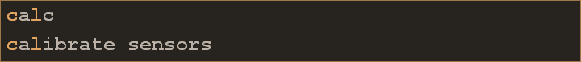
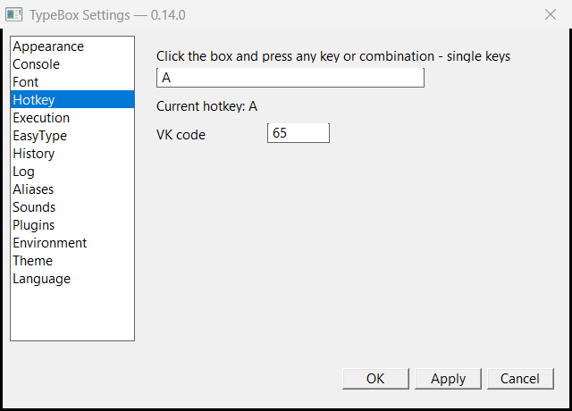
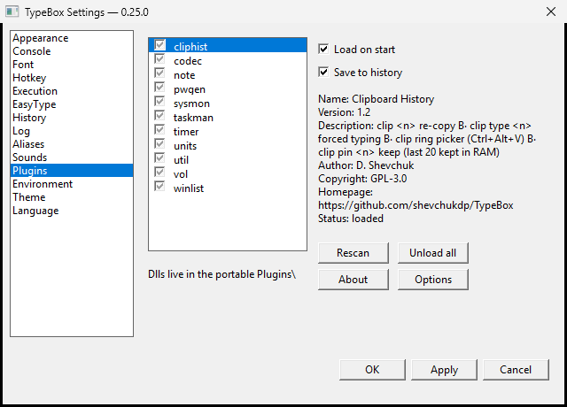
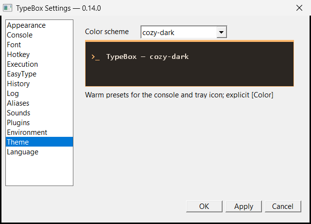
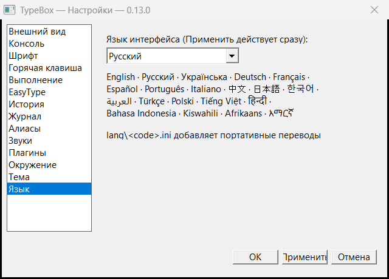

# TypeBox

[](https://github.com/shevchukdp/TypeBox/actions/workflows/build.yml)
[](https://github.com/shevchukdp/TypeBox/releases)
[](LICENSE)

**Universal hotkey console + bash + launcher for Windows.** Press a shortcut, type, hit Enter — TypeBox runs what you mean: apps, aliases, commands, URLs, files, plugins.

One **portable folder** with an **INI file** you can carry on a USB stick, keep in Git, or **export/import** between machines — the feature modern launchers forgot.

**Download:** [latest release](https://github.com/shevchukdp/TypeBox/releases) — unzip, run `TypeBox.exe`, hotkey `Ctrl+Shift+F2`.

## Screenshots

| The console (hotkey → type → Enter) | Drop-down suggestions (v0.10) | Settings → Environment: own PATH & variables |
|---|---|---|
|  |  |  |

| Appearance | Font | Hotkey capture |
|---|---|---|
|  |  |  |

| Alias editor | Plugin manager |
|---|---|
|  |  |

| `clip ring` — topmost clipboard picker (v0.24) | `note list` — quick capture to markdown (v0.25) | Settings → Plugins checklist (v0.25) |
|---|---|---|
|  |  |  |

| Settings → Theme (cozy presets) | Settings → Language (20 UI languages) | The same page, Russian UI |
|---|---|---|
|  |  |  |

> ### Roots & inspiration
> **TypeBox is maintained by Dima Shevchuk (D. Shevchuk)** — [github.com/shevchukdp](https://github.com/shevchukdp), and the same author/maintainer line is shown in the built-in About box (`/about`).
>
> **TypeBox grows out of [TypeAndRun](https://github.com/galancev/typeandrun)** by Evgeniy Galantsev (2001–2004, GPL-3.0) — the **direct ancestor** whose idea, command/alias engine and INI config schema this project continues.
> The UX and feature set draw inspiration from:
> **[Microsoft PowerToys Run](https://learn.microsoft.com/windows/powertoys/run)** (quick-launch UX), **[Flow Launcher](https://www.flowlauncher.com/)** (open plugin ecosystem), **[Wox](https://github.com/Wox-launcher/Wox)** (GPL-3.0 ancestor of PowerToys Run), **[Raycast](https://www.raycast.com/)** (rich display, extensions), **[Alfred](https://www.alfredapp.com/)** / **Quicksilver** (historical launchers), **[ConEmu](https://conemu.github.io/)** (proof that a portable INI config works for Windows tools), and drop-down terminals **[Guake](https://github.com/Guake/guake)** / **[Yakuake](https://kde.org/applications/utilities/org.kde.yakuake)** / **[Drop](https://github.com/marcinwicherek/drop)** (the console/bash mode UX).

> **Корни и вдохновение.** TypeBox вырос из **TypeAndRun** (Evgeniy Galantsev, [galancev/typeandrun](https://github.com/galancev/typeandrun), GPL-3.0): идея, движок команд/алиасов и INI-схема конфига продолжаются напрямую из него. UX и набор фич вдохновлены Microsoft PowerToys Run, Flow Launcher, Wox, Raycast, Alfred, а режим консоли/bash — drop-down терминалами Guake / Yakuake / Drop. Портативный INI-конфиг — по образцу ConEmu.

## Why TypeBox

| | **TypeBox** | TypeAndRun | PowerToys Run | Flow Launcher |
|---|---|---|---|---|
| Hotkey → type → run | ✅ | ✅ | ✅ | ✅ |
| Aliases with `%s`/`%1..%n` + env vars | ✅ | ✅ | ❌ | ❌ |
| Config format | **INI** | INI | JSON (`%LOCALAPPDATA%`) | JSON |
| Portable (folder moves with config) | ✅ | ✅ | ❌ | ❌ |
| Settings import / export | ✅ | manual | partial (JSON, since 0.64) | ❌ |
| Plugins | ✅ (native DLL ABI compatible with TypeAndRun) | ✅ | ✅ | ✅ |
| Console / bash mode | ✅ (planned) | partly | ❌ | ❌ |

TypeBox keeps the soul of TypeAndRun (aliases, `%s`, `%TYPEBOXDIR%`, history, undo, sounds, INI) and takes the quick-launch UX from PowerToys Run / Flow Launcher / Raycast.

## Features

**Where TypeBox stands:** everything below ships in **[v0.25.0](https://github.com/shevchukdp/TypeBox/releases/latest)** — the current release.
The project evolves in focused waves: one release ships a theme (v0.24 was the clipboard-picker wave, v0.25 is quick capture + plugin control), each gated by its
own test suite and re-verified against the **actual downloaded release bytes** before it is announced. Full history in
[CHANGELOG.md](CHANGELOG.md), the living plan in [docs/ROADMAP-50.md](docs/ROADMAP-50.md). Next wave: **v0.26.0 — `yt` video search**.

Working today (v0.25.0 — 12 plugins ship ready-to-use):
- 🔎 **Web-search quicklinks** — `[WebSearch] so=https://…%s`: `so hello world` opens the default
  browser (built-in g/yt/gh); logged, history-friendly, amber anchor
- ⌨️ **Alt+1…9 quick-select** — the drop-down numbers its rows; Alt+digit runs one instantly;
  ↑/↓ + wheel scroll long lists, and a hover no longer hijacks **Enter**
- ✅ **Fuzzy matching** — `[Type] Fuzzy=1` (default): Tab and the drop-down score subsequences,
  so `cl` finds `calc`; hit characters glow in the accent color, best score on top, `Fuzzy=0`
  restores the strict TypeAndRun prefix mode
- ✅ **Drop-down suggestions** — TypeAndRun's `frmTypeDropDown` reborn, themed by `[Theme]`:
  ET candidates for the word at the caret (aliases · `~sysalias` · `/commands` · plugins) or the
  history on an empty line; ↑/↓ · Tab accept · Enter run · Esc close · mouse click;
  `[DropDown] Enable/Lines/ShowHistoryOnEmpty`, EasyType page controls
- ✅ **Cozy themes + visual anchors** — 7 warm presets (`[Theme]`, Theme page, live
  preview), GDI-drawn tray badge (accent rim, state dot), console status strip
  (counts · chips · clock) and a traffic light previewing Enter: 🟢 your alias/~/cmd,
  🟡 PATH/file/URL/plugin, 🔴 shell catch-all — per keystroke, localized labels
- ✅ **Theme studio** (v0.15) — create your own themes without touching INI by hand:
  native color pickers (bg/text/accent/border), border thickness, transparency, console
  width/height, font family/size/bold, live preview card; themes save as portable
  `themes\<name>.theme.ini` files — copy the folder, take your looks anywhere
- ✅ **Localization — 20 languages, everywhere** (en ru uk de fr es pt it complete +
  zh ja ko ar tr pl vi hi id sw af am core): tray, balloons, help/about, whole settings
  dialog; `[UI] Language`, Language page, Arabic RTL, CJK/RTL font auto-suggestion,
  portable `lang\<code>.ini` overrides — [docs/LANGUAGE.md](docs/LANGUAGE.md)
- ✅ **Own PATH & variables** — `[Path]` folders + `[Variables]` like the Windows
  *Environment Variables* dialog, but portable: typed names launch from your folders,
  PATH is injected for aliases/shell/children, `%NAME%` expands everywhere — `/path`,
  Settings → Environment
- ✅ **Settings dialog** — 14 pages (Appearance · Console · Font · Hotkey · Execution ·
  EasyType · History · Log · Aliases editor · Sounds · Plugin manager · Environment ·
  Theme · Language), scratch copy + Cancel,
  live-apply on OK/Apply (hotkey re-registration, font, geometry, alpha, priority, tray,
  plugin load state, UI language) — `/settings`, tray menu
- ✅ Global hotkey — **any key, no limits** (v0.13): single keys, media keys, `Esc`; low-level
  hook fallback when `RegisterHotKey` refuses (`[HotKey] Key / AltKey / CtrlKey / ShiftKey / WinKey`)
- ✅ Console-like popup (top-most, centered, transparent, font from INI, DPI-aware, AutoHide)
- ✅ Command engine: aliases with `%s` / `%1..%n`, env vars (`%VAR%`, `%TYPEBOXDIR%`),
  legacy pipe form `action|dir|state`, URLs, `mailto:`, files/folders, shell (`cmd.exe /c`)
- ✅ **System aliases** (`[SysAliases]`): `~lock · ~logoff · ~sleep · ~screensave · ~reboot`
  defaults, user table overridable; **Shift+Enter** kills the last alias process
- ✅ **Ignores.ini (BadApp)** — stay hidden over listed apps (process/class, wildcards)
- ✅ **All 14 TypeAndRun internal commands** (`/about … /unload`) + `/export` `/import` `/undo` `/log` `/sys` `/update`
- ✅ **Plugin host — TypeAndRun ABI-compatible** (`Load/Unload/GetInfo/GetCount/GetString/RunString → TExec`):
  drop DLLs into the portable `Plugins\` folder; ships ready-to-use **units** (`conv 10 km mi`,
  `hex 255`→`FF`), **codec** (`b64enc`, `urlenc`, `hexdec`), **vol** (`vol + / mute / 3`),
  **cliphist** (`clip 3` re-copies the 3rd last copied text, `clip pin 2` keeps an entry safe
  from trimming, `clip paste 1` pastes it at the caret, `clip type 1` *types* it per char for
  apps that block Ctrl+V, `clip ring` / `Ctrl+Alt+V` opens the topmost picker), **taskman** (`task chrome`,
  `kill notepad`, `top` live CPU ranking, `restart notepad` kill+relaunch) and
  **winlist** (`win notepad` raises the window), **pwgen** (`pw 20 s` strong passwords,
  `[Pwgen]` defaults), **timer** (`timer 25m tea` countdown + `sw` stopwatch with
   a topmost mini label, `[Timer]` defaults), **sysmon** (`cpu`, `ram`, `batt`, `disk`, `sys` - sampled
   CPU percent, clipboard hand-off, `[Sysmon]` defaults) and **util** (`ts 1763385000` epoch↔ISO,
   `ts clip`, `slug Привет мир` → `privet-mir` with the result on the clipboard, `sha256 file` +
   `sha256 /verify SUMS` checksum checks), **note** (`note` opens the quick-capture editor,
   `note <text>` saves a markdown file, `note + <text>` appends a timestamped bullet to
   today's journal), plus the calculator example in
   [`examples/plugin_calc`](examples/plugin_calc/calc.c)
 - ✅ **Positions & stay-awake** (v0.23) — `pos right` / `pos q3` / `pos center` dock the console
   into FancyZones-style slots of the current monitor, `pos <name>` uses a `[Positions]` preset
   (`mycorner=10,20,300,120`), and `stayawake [min]` keeps the screen on without any service
   (`SetThreadExecutionState`, off with `stayawake off`) — the console still returns to its INI
   home position after a restart
  - ✅ **Clipboard picker, forced typing, checksums** (v0.24) — `clip ring` (or the
    `[Clipboard] Ring` hotkey, `Ctrl+Alt+V` by default) opens a topmost picker: arrows move,
    Enter copies, Ctrl+Enter types the entry straight into the app behind the console,
    Esc dismisses; `clip type <n>` injects it per-character via SendInput for apps that
    block Ctrl+V; `sha256 <file>` puts a digest on the clipboard and `sha256 /verify SUMS`
    checks a GNU/BSD checksum list the way `sha256sum -c` does
  - ✅ **Quick capture & plugin control** (v0.25) — `note` opens a topmost capture editor
    (clipboard prefilled, Ctrl+Enter saves a `YYYY-MM-DD-HHmm-title.md` into `[Notes] Folder`,
    your vault stays plain markdown); `note + text` lands a timestamped `- [HH:mm] …` bullet
    in today's journal like Obsidian QuickAdd; and Settings → Plugins is now a checklist —
    click any plugin to turn it off (or back on), persisted to `[PluginState]`, no INI editing
- ✅ **Scripts folder** (v0.16) — any `*.bat/*.cmd/*.ps1/*.py/*.vbs` dropped into the portable
  `Scripts\` folder becomes a command by its file name (`backup C:\Data` → `Scripts\backup.ps1`),
  arguments passed through; re-scan with `/reread`
- 🛡️ **The safe Run box** (v0.16) — ClickFix-style payload guard: encoded one-liners
  (`powershell -enc …`, base64 blobs, `certutil`/`bitsadmin`/`mshta`, curl-pipe-shell …) ask for
  confirmation before the shell runs them (`[Security] ConfirmSuspicious`, on by default);
  destructive commands (`del`/`format`/`shutdown`/`reg delete`/`rm -r`…) ask too
  (`[Security] ConfirmDanger`) — on aliases, scripts and the shell alike
- ⚡ **Run as administrator** (v0.18) — start any line with `su`, `/su` or `sudo`
  (`su taskmgr`, `sudo regedit`, `su backup`) and it launches elevated through UAC;
  aliases, `Scripts\` scripts, files and shell commands all support it, the
  status strip shows an **admin** chip while you type
- 🏆 **Frecency ranking** (v0.17) — the drop-down learns what you actually run
  (`Usage.dat`), most-used commands win ties; `[Type] FrecencyRanking`
- 🗂️ **TypeBox.local.ini** (v0.17) — per-machine overrides merged over the portable
  `TypeBox.ini`: share your config on a network drive, keep your own position/theme/language
  in the local file
- 🖱️ **Console context menu** (like the original TypeAndRun) — right-click the console:
  Undo/Cut/Copy/Paste/Select All · Settings · Aliases · Plugins · Theme · Language ·
  Reload config · Open config folder · About · Help · Hide · Exit — all 20 languages
- ✋ **Grab and drag the console** (v0.19) — press and drag the 20 px status strip at the
  bottom of the console and the whole window follows the mouse (standard Windows move,
  works across monitors); the spot is remembered for the session, and a restart always
  brings the console back to its INI home position (`[Show] X/Y`, `[Show] DragMove`)
- ✅ **EasyType completion** — `Tab` completes from commands/aliases/sys-aliases/plugins/history, cycles on repeat
- ✅ Tray icon + balloon tips · sounds per execution type · undo (`Ctrl+Z`)
- ✅ Persistent history (`↑/↓`, portable `History.dat`, per-type toggles) · single instance + `WM_COPYDATA` IPC
- ✅ INI config next to the exe — portable

Planned (full backlog of 50+ vetted ideas in [docs/ROADMAP-50.md](docs/ROADMAP-50.md) — [docs/PLAN.md](docs/PLAN.md) keeps the original plan):
- 🏗️ **In progress — v0.26.0**: `yt <query>` video search right in the console —
  top results with titles/durations, `yt <n>` opens one in the browser; optional
  `[Youtube] ApiKey` (Data API v3), keyless public-instance fallback, and the
  network is touched **only** when you type the command, like `/update`
- Info display (calculator, web results, files, system status — like PowerToys Run modules)
- Drop-down terminal / bash mode (Guake/Yakuake/Drop style)

## Everything TypeAndRun had — and more

The goal is **full feature parity with the ancestor, plus modern additions**. The complete
checklist — every option of `Settings.pas`/`ForAll.pas` (`[Show] [HotKey] [Font] [Type] [Exec]
[History] [Path] [Registry] [Language] [Undo] [Sounds] [Config] [Coordinates] [Hint] [DropDown] [Color]`,
system aliases, EasyType completion, 14 internal commands, plugin ABI, single-instance IPC)
with status and the "beyond TypeAndRun" list (portable INI, import/export, Unicode, fuzzy search,
info modules, ConPTY terminal mode, profiles) — is in **[docs/FEATURES.md](docs/FEATURES.md)**.

## Docs

- [CHANGELOG.md](CHANGELOG.md) — what shipped in every release, gate counts included
- [docs/ROADMAP-50.md](docs/ROADMAP-50.md) — the living roadmap: adopted ideas, release picks, shipped status
- [docs/FEATURES.md](docs/FEATURES.md) — parity checklist vs TypeAndRun + additions
- [docs/PLAN.md](docs/PLAN.md) — the original plan (MVP → plugins → info → bash/terminal)
- [docs/CONFIG.md](docs/CONFIG.md) — INI schema, portability, import/export, migration
- [docs/LANGUAGE.md](docs/LANGUAGE.md) — 20 UI languages, RTL, portable translation packs
- [docs/PLUGIN_API.md](docs/PLUGIN_API.md) — TypeAndRun-compatible plugin ABI

## Config & portability

All settings live in **`TypeBox.ini`** next to the executable — nothing in the registry, nothing in `%APPDATA%`. Copy the folder → your setup moves with you. "Import/export" = copy/swap the file (a UI action will wrap this).

The schema is compatible with the legacy `TypeAndRun.ini` (sections `[HotKey]`, `[Show]`, `[Exec]`, `[History]`, `[Sounds]`, `[Config]`, `[Hint]`, `[DropDown]`, `[Color]`) so old configs can be imported. See [docs/CONFIG.md](docs/CONFIG.md).

## Building

CMake (MSVC or MinGW):
```
cmake -S . -B build && cmake --build build --config Release
```
MSVC directly:
```
cl /EHsc /std:c++17 /DUNICODE /D_UNICODE /DTYPEBOX_VERSION=0.0.0-dev src\main.cpp /Fe:TypeBox.exe ^
   /link /SUBSYSTEM:WINDOWS user32.lib shell32.lib shlwapi.lib gdi32.lib comctl32.lib winmm.lib
```
MinGW-w64 directly (add `-static` so the exe needs no MinGW runtime DLLs):
```
g++ -std=c++17 -DUNICODE -D_UNICODE -DTYPEBOX_VERSION=0.0.0-dev -O2 src/main.cpp -o TypeBox.exe ^
    -municode -mwindows -static -luser32 -lshell32 -lshlwapi -lgdi32 -lcomctl32 -lwinmm
```
The version comes from the `VERSION` file (CI refuses a tag that doesn't match it).

## License

GPL-3.0 — the same license as the ancestor project, TypeAndRun. See [LICENSE](LICENSE).
