# TypeBox

[](https://github.com/shevchukdp/TypeBox/actions/workflows/build.yml)
[](https://github.com/shevchukdp/TypeBox/releases)
[](LICENSE)

**Universal hotkey console + bash + launcher for Windows.** Press a shortcut, type, hit Enter — TypeBox runs what you mean: apps, aliases, commands, URLs, files, plugins. It exists because modern launchers forgot the parts people kept asking for: one **portable folder** with an **INI file** you can carry on a USB stick, keep in Git, or **export/import** between machines — and an **offline-first** promise: nothing ever touches the network unless you typed a command that needs it (`yt`, `/update`).

**Download:** [latest release](https://github.com/shevchukdp/TypeBox/releases) — unzip, run `TypeBox.exe`, hotkey `Ctrl+Shift+F2`.

## Screenshots

| The console (hotkey → type → Enter) | Drop-down suggestions (v0.10) | Settings → Environment: own PATH & variables |
|---|---|---|
|  |  | 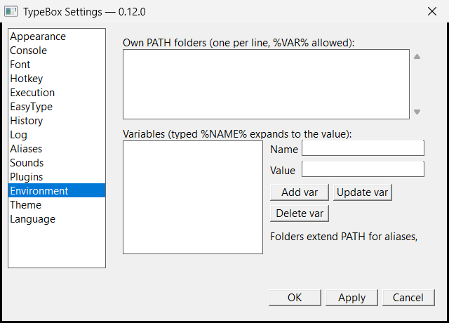 |

| Appearance | Font | Hotkey capture |
|---|---|---|
|  |  |  |

| Alias editor | Plugin manager |
|---|---|
|  | 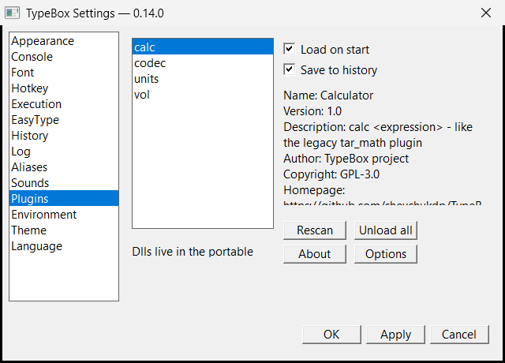 |

| `clip ring` — topmost clipboard picker (v0.24) | `note list` — quick capture to markdown (v0.25) | Settings → Plugins checklist (v0.25) |
|---|---|---|
| 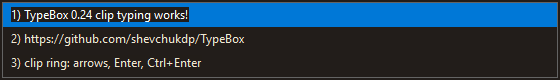 |  |  |

| `yt <query>` — videos in the console (v0.26) | `yt` usage — three-tier search, network only on a typed line (v0.26) |
|---|---|
| 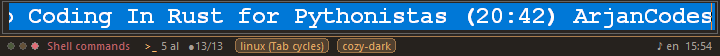 |  |

| `weather Kyiv` — now + today/tomorrow in one line, keyless Open-Meteo (v0.28) |
|---|
| 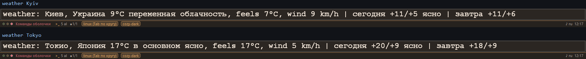 |

| Ctrl+R bck-i-search — bash-style history filter (v0.27) | `/tabs` — one Enter, a page of tabs (v0.27) | `/day` — today's usage tally (v0.27) |
|---|---|---|
| 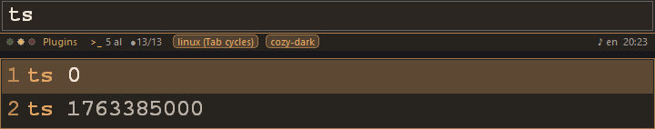 | 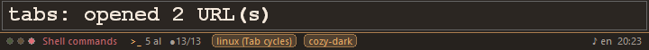 |  |

| `pos right` — slot docking that never stretches the console; `pos reset` returns the INI home (v0.27.1) |
|---|
|  |

| Settings → Theme (cozy presets) | Settings → Language (20 UI languages) | The same page, Russian UI |
|---|---|---|
|  |  |  |

| Ghost text, accepted lines, snippets and search engines — the v0.33 «write less» wave |
|---|
| 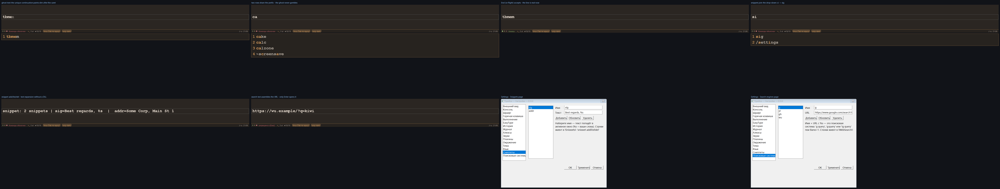 |

| `in 10m tea`, `at 18:30 backup`, `/timers`, and `/dnd` keeping the night quiet — the v0.34 «time machine» wave |
|---|
| 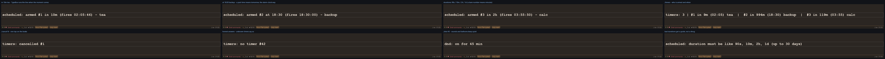 |

| `/stats` dashboards, starred favorites and a calmer boot — the combined v0.35 wave |
|---|
| 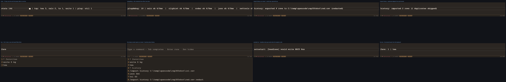 |

| write a plugin in five minutes: SDK header, sidecar manifest, `/reload` — the v0.36 plugin DX wave |
|---|
| 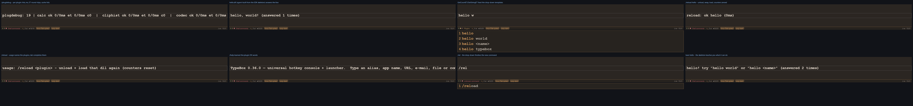 |

## Why TypeBox

| | **TypeBox** | TypeAndRun | PowerToys Run | Flow Launcher |
|---|---|---|---|---|
| Hotkey → type → run | ✅ | ✅ | ✅ | ✅ |
| Aliases with `%s`/`%1..%n` + env vars | ✅ | ✅ | ❌ | ❌ |
| Config format | **INI** | INI | JSON (`%LOCALAPPDATA%`) | JSON |
| Portable (folder moves with config) | ✅ | ✅ | ❌ | ❌ |
| Settings import / export | ✅ | manual | partial (JSON, since 0.64) | ❌ |
| Plugins | ✅ (native DLL ABI compatible with TypeAndRun) | ✅ | ✅ | ✅ |
| Console / bash mode | console ✅ · bash mode planned | partly | ❌ | ❌ |

TypeBox keeps the soul of TypeAndRun (aliases, `%s`, `%TYPEBOXDIR%`, history, undo, sounds, INI) and takes the quick-launch UX from PowerToys Run / Flow Launcher / Raycast.

## Working today (v0.36.0)

Everything below ships in **[v0.35.0](https://github.com/shevchukdp/TypeBox/releases/latest)** — the current release (v0.32 taught the launcher **native typing** — `дфя` finds `laz`, v0.33 teaches it to **write less** — ghost completions, remembered arguments, snippets, your own search engines, v0.34 hands it a **time machine** — scheduled commands and Do Not Disturb, v0.35 combines **dashboards, favorites and a calmer boot** — `/stats`, `/plugdebug`, CSV history, Ctrl+S favorites, `autostart`, v0.36 opens the **plugin workshop** - SDK header + reference skeleton, sidecar manifests with a word law, `/reload` hot-reload, per-plugin performance counters). The project evolves in focused waves (v0.27 the power-user console wave, v0.28 the weather wave, v0.29 the sharp-screen wave, v0.30 the plugin wave, v0.31 the wake-on-LAN wave, v0.32 the native-typing wave, v0.33 the write-less wave, v0.34 the time machine wave, v0.35 the dashboards wave, v0.36 the plugin DX wave), each gated by its own test suite and re-verified against the **actual downloaded release bytes** before it is announced. Full history in [CHANGELOG.md](CHANGELOG.md), the living plan in [docs/ROADMAP-50.md](docs/ROADMAP-50.md), and the ordered master plan to v1.0/v1.5 in [docs/ROADMAP-V1.md](docs/ROADMAP-V1.md).

**Plugin DX (v0.36)**

- **One-file SDK** - `include/typebox_plugin.h` + the compiling reference plugin
  [`examples/plugin_skeleton`](examples/plugin_skeleton/skeleton.c): copy the folder, change the word and
  the answer, build with one `gcc` line; CI compiles the skeleton every run as the ABI proof.
  [AGENTS.md](AGENTS.md) spells the same contract for AI agents - spec in, working dll out
- **Sidecar manifests** - `<dll>.tbplugin.json` declares `words`, `author`, `hostmin`; the host refuses
  to load a dll whose declared word collides with a host command or another plugin (the `audit-words`
  rule, now enforced at runtime), and honors `hostmin` before it calls a single export. No manifest,
  no problem: every v1 plugin loads exactly as before
- **Hot reload** - `/reload <plugin>` or the **Reload** button on Settings > Plugins: unload, swap the
  dll on disk, reload, counters zeroed - iterate on a plugin without leaving the console. As a side
  effect this wave found and fixed a real landmine: plugins that registered their message windows under
  the *exe's* module left a class with a `WndProc` in freed memory after reload (a rare 0xc0000005);
  cliphist/sysmon/timer now register under their own module and unregister on `Unload`
- **Performance track (Section 4b)** - `/plugdebug` grew per-plugin ET round-trip counters and cache
  hits (`<key> ok 3/1ms et 2/0ms c1`), drop-down template results are LRU-cached per plugin (8 entries,
  8 s, invalidated by `/reread`/`/reload`/rescan), and any plugin `Load()` past its 20 ms budget
  logs itself - slow plugins can hide nowhere

**Dashboards, favorites & a calmer boot (v0.35)**

- **`/stats`** — the last 14 days as a one-line sparkline (`▁▂▄▆█` block glyphs), the top five
  commands with their counts, and how often each plugin answered: all from `Usage.dat`, no
  new files, no network — `stats 14d ▂▅▇▃ | top: calc 12, ff 4 | plug: util 3/2ms`
- **`/plugdebug`** — who answered, how often, how slow; a plugin that faults is respectfully
  retired for the rest of the session (the host survives one bad DLL now), and every plugin
  gets its writable home `Data\<dll>\` pre-created next to the exe
- **History as CSV** — `/export history <file.csv> [redact]` writes a BOM'd Excel-friendly
  CSV; `redact` keeps every command word but drops every argument, so the file is safe for a
  bug report; `/import history <file.csv>` merges old rows back, duplicates skipped, the
  `[History] Max` cap honored. The old bare `/export <file>` INI copy is untouched
- **Favorites** — `Ctrl+S` stars the highlighted drop-down row (or the whole line you typed)
  into `Favorites.dat`; typing `favs ` filters them, with `* favorites` / `* history` section
  headers appearing only once you have stars — arrows, Alt+digits and clicks skip headers, and
  `favs` / `favs <text>` / `favs clear` keep the board inspectable from the keyboard
- **`autostart on|off|status`** — the HKCU Run key without leaving the console; under headless
  the registry is never touched (the answer only says `would write`/`would delete`, the
  offline-first law extended to the registry), and `status` stays a safe read
- **Tray Do Not Disturb** — the tray menu grew a checkable night switch next to the `/dnd`
  word and the `[Sounds] Quiet` window

**Time machine (v0.34)**

- **Scheduled commands** — `in 10m <cmd>` and `at 18:30 <cmd>` run the very line you would have
  typed: `90s / 10m / 2h / 1d` (a bare number means minutes, 30 days max), a past `at` means
  tomorrow, the alarm-clock way; timers survive restarts (`Timers.dat` next to the exe), but a
  moment that passed while TypeBox slept is *missed*, not run — nothing blind-fires at boot
- **`/timers` / `/cancel <n>` / `/cancel all`** — who is armed, and a way to disarm; internal
  commands and other timers refuse to be scheduled (no `in 10m /exit`, no timer recursion)
- **Tray balloon when it fires** — the human gets a notification, the log keeps the receipt;
  dangerous commands are skipped at fire time (`skipped #N … (dangerous)`), even in a dry run
- **Do Not Disturb** — `/dnd [min]` shushes the execution sounds and every tray balloon
  (indefinite or for N minutes, `/dnd off` ends it), and `[Sounds] Quiet=22:00-07:30` arms the
  same silence nightly — a window that wraps midnight included

**Write less (v0.33)**

- **Ghost text** — type a unique prefix and the rest of the winning suggestion appears after the
  caret in dim paint: `End` (or `Right`) accepts it, typing on just narrows it. Strictly the
  *unique* match: two candidates sharing the prefix and the ghost stays out of the way — accepting
  is never a gamble; layout `~` and spell `≈` rows never ghost (`[Type] Ghost=1`)
- **Remembered arguments** — `ff a b` once, and tomorrow `ff x` still fills `%2` with `b`
  (per-alias, per-slot, in `Usage.dat` next to your usage stats; `[Type] ArgMemory=1`)
- **Snippets** — `[Snippets] sig=Best regards, %s` + typing `sig John Doe` lands the expanded
  text in the window behind the console (clipboard + one Ctrl+V; headless only logs `would
  paste`); `snippet add|list|del` from the line, a Settings page, ET rows and spell rows included
- **Your own search engines** — `[WebSearch] name = https://…%s` is a plugin without a DLL:
  `g query`, `g:query`, and with `Bang=1` the `!g query` form; `search add|list|del|test`
  manage them without opening the INI (`test` assembles the URL — only Enter opens it), plus
  their own Settings page. Offline-first intact: this wave never touches the network

**Native typing (v0.32)**

- **Layout fallback** — the wrong keyboard layout no longer stops you: with ЙЦУКЕН on, the physical
  `l a z` keys print `дфя` — and the drop-down still offers the alias `laz`, Tab still completes it,
  Enter still runs it (both directions, exact match on Enter, real hits always win ties). Layout-only
  rows are painted with a `~` so the help never masquerades as a guess; `[Type] LayoutFallback=1`,
  prefix mode included; the log marks it: `alias started: ghb (layout: при)`
- **Spell-suggest** — when nothing matches, the drop-down offers up to three `≈ candidate` rows within
  two edits of the typed word (aliases, plugin words, quicklinks, commands); picking one writes the
  real word and Enter runs it
- **`/checkconfig` v2** — a real config audit into the console (copyable) and the dialog: dead aliases
  (target not found on disk, in PATH, as URL or via a trusted shell host) get `DEAD: name -> target`
  plus a one-line `maybe '…'` fix; duplicate alias names counted, every finding logged
- **Keystroke perf track** (first ROADMAP-V1 §4b item) — the suggestion list rescans only when the
  caret word actually changes; an identical keystroke reuses the cached list instead of re-asking
  all 19 plugins for ET rows

**Wake-on-LAN + the word law (v0.31)**

- **`wol`** (plugin #19, RI3 #238) — `wol <MAC|name> [host [port]]` sends the magic packet
  (6×FF + 16×MAC over UDP broadcast, ws2_32 only): MAC accepts `AA:BB:CC:DD:EE:FF`,
  `AA-BB-…`, `AA.BB.CC.DD.EE.FF` or plain `AABBCCDDEEFF`; `[Wol]` INI gives named presets
  (`gatepc = AA:BB:CC:DD:EE:FF 192.168.1.255 7`), `Host/Port/Repeat` defaults and
  `wol list` — pure INI, zero network until you type the line
- **Power-family safety, same contract as `off`**: under `TYPEBOX_HEADLESS=1` the packet is
  NEVER put on the wire — the answer is `wol: [headless] would send magic packet to
  AA:BB:CC:DD:EE:FF via 255.255.255.255:9 (3 packets)`, so test suites can never wake anything
- **The word law** — every command word across the host and all 19 plugins is globally unique,
  asserted by `tools/audit-words.ps1` as a hard build gate (the v0.30.0 shadowing bug is now
  structurally impossible); first act of the law: taskman's `restart <proc>` became
  **`relaunch`** — `restart` belongs to `off.dll` alone (off.dll keeps the reboot word)

**Four new plugins (v0.30)**

- **`nettools`** — `ip` (public IP, cached), `w <city>` (one short wttr.in line, remembers the
  last city), `dns <host>` (answers offline for localhost/hosts-file names), `netinfo`
  (adapters with IPv4/mask/gateway), `ping <host> [n]` (real ICMP round-trips) — the same
  offline-first rule: the network is touched only on a line you typed. The full `weather`
  command stays with the v0.28 `weather` plugin (rich answer with feels/wind/today/tomorrow)
  — v0.30.1 split the words so the two plugins never shadow each other
- **`off`** — `off [now|<min>|cancel]`, `restart [min]`, `off sleep|hibernate|hybrid|logoff`;
  `[Off] Confirm/WarnSec` guard a stray Enter, and in headless mode every power action is a
  dry-run answer (`off: [headless] would run shutdown /s /t 1800`) — test suites can never
  touch your power state
- **`todo`** — `todo buy milk tomorrow 18:00` (parses `today · tomorrow · fri · +2d · +5h ·
  18:00 · 2026-11-20`), plus `todo`, `todo today`, `todo done <n>`, `todo del <n>` — a plain
  UTF-8 `todo.txt` next to the exe, overdue items flagged `!!`
- **`json`** — `json fmt|min|keys <text>`, `json get a.b[2].c <text>`, and `jwt <token>`
  decode with humanized `iat`/`exp` (UTC + expired verdict) — pure computation, zero network
- All four speak the TypeAndRun-compatible plugin ABI, land in the (now 18-row)
  Settings → Plugins checklist, and are proven by `test-v0300`: **59 assertions** on the
  real host, power actions verified as dry-runs

**Sharp on any monitor (v0.29)**

- **Per-Monitor V2 DPI** — drag the console between displays with different scaling: geometry,
  fonts, the status strip, the drop-down, the settings dialog and plugin windows all re-scale
  live through `WM_DPICHANGED`; on Win8.1 it degrades to Per-Monitor, on Win7/8 to the old
  system awareness — same binary, no manifest games
- **Your INI never changes with your monitor** — every pixel value (`[Show]`, `[Positions]`,
  `[Font] Size`, the strip, the settings dialog) is 96-logical and scaled per window with
  `MulDiv`, so `Width=720` means 720 logical px at 100% and 1080 crisp physical px at 150%
- **Honest gates for it** — a windowless `--dpi-math` table (exact MulDiv values 96..240) and
  synthetic DPI-change injection in the harness prove the real code path on a 100%-scaled
  test machine, pixel-exact round trips included (`test-v0290`: 28 assertions)

**The power-user console (v0.27)**

- **Ctrl+R reverse history search** — bash-style: press Ctrl+R, keep typing to filter your command
  history (newest first, `|bck` marker in the status strip), Ctrl+R cycles further back,
  Enter runs, Esc restores your line, Tab exits with the text kept
- **`/day`** — today's usage at a glance: what you ran today and how often, straight in the
  console line (fed by a per-day tally in `Usage.dat`, the TypeAndRun history format extended)
- **`/tabs url1 url2 …`** — one Enter opens the whole page of tabs in your browser (https://
  auto-prefixed, up to 10 at a time); logged, history-friendly
- **Headless test mode** — `TYPEBOX_HEADLESS=1` / `--headless-tests` parks the console, Settings
  and clip ring off-screen and skips sounds, balloons and hotkey grabs, so automated suites never
  disturb the human at the keyboard — nothing is faked, features stay fully testable

**Find & launch**

- **Drop-down suggestions** — TypeAndRun's `frmTypeDropDown` reborn, themed by `[Theme]`:
  candidates for the caret word (aliases · `~sysalias` · `/commands` · plugins) or the history
  on an empty line; ↑/↓ · Tab accept · Enter run · Esc close · mouse click · wheel scroll, and a
  hover no longer hijacks **Enter**
- **Fuzzy matching** — `[Type] Fuzzy=1` (default): Tab and the drop-down score subsequences,
  so `cl` finds `calc`; hit characters glow in the accent color, best score on top, `Fuzzy=0`
  restores the strict TypeAndRun prefix mode
- **Alt+1…9 quick-select** — the drop-down numbers its rows; Alt+digit runs one instantly
- **Web-search quicklinks** — `[WebSearch] so=https://…%s`: `so hello world` opens the default
  browser (built-in g/yt/gh); logged, history-friendly, amber anchor
- **Command engine** — aliases with `%s` / `%1..%n`, env vars (`%VAR%`, `%TYPEBOXDIR%`), legacy
  pipe form `action|dir|state`, URLs, `mailto:`, files/folders, shell (`cmd.exe /c`)
- **Global hotkey — any key, no limits**: single keys, media keys, `Esc`; low-level hook fallback
  when `RegisterHotKey` refuses (`[HotKey] Key / AltKey / CtrlKey / ShiftKey / WinKey`)
- **System aliases** (`[SysAliases]`): `~lock · ~logoff · ~sleep · ~screensave · ~reboot`
  defaults, user table overridable; **Shift+Enter** kills the last alias process
- **All 14 TypeAndRun internal commands** (`/about … /unload`) + `/export` `/import` `/undo` `/log` `/sys` `/update`
- **Scripts folder** — any `*.bat/*.cmd/*.ps1/*.py/*.vbs` dropped into the portable `Scripts\`
  folder becomes a command by its file name (`backup C:\Data` → `Scripts\backup.ps1`), arguments
  passed through; re-scan with `/reread`
- **Frecency ranking** — the drop-down learns what you actually run (`Usage.dat`), most-used
  commands win ties; `[Type] FrecencyRanking`

**Clipboard, capture & the web — offline-first to the letter**

- **`clip ring`** (or the `[Clipboard] Ring` hotkey, `Ctrl+Alt+V`) — topmost clipboard picker:
  arrows move, Enter copies, Ctrl+Enter types the entry into the app behind the console;
  `clip type <n>` injects it per-character via SendInput for apps that block Ctrl+V;
  `clip pin` keeps an entry safe from trimming, `clip paste` types it at the caret
- **`note`** — topmost quick-capture editor (clipboard prefilled, Ctrl+Enter saves a
  `YYYY-MM-DD-HHmm-title.md` into `[Notes] Folder`, your vault stays plain markdown);
  `note + text` lands a timestamped `- [HH:mm] …` bullet in today's journal
- **`yt <query>`** — the top videos printed right in the answer line, `yt <n>` opens one;
  three tiers (optional `[Youtube] ApiKey`, keyless Piped/Invidious, then the results page).
  The offline-first rule holds: **the network is touched only when you type the command**,
  exactly like `/update`; no key, no account, no telemetry
- **`weather <city>`** — one line: now (° + condition + feels + wind) plus **today and
  tomorrow** highs/lows, keyless Open-Meteo; `weather` falls back to `[Weather] City`,
  then IP geolocation; `weather /clear` forgets the cache. Same rule: the network wakes up
  only for the line you typed — unreachable network answers honestly, never hangs
- **`/update`** — one release-API check, only when you type it; the zip's **SHA-256 is verified
  against the published digest** before anything is unpacked, then staged and self-installed —
  your `TypeBox.ini` is never overwritten
- **util plugin** — `ts 1763385000` epoch↔ISO (`ts clip`), `slug Привет мир` → `privet-mir`
  on the clipboard, `sha256 <file>` + `sha256 /verify SUMS` the way `sha256sum -c` does

**Positioning & safety**

- **`pos` slots + `pos reset`** (v0.23, fixed in v0.27.1) — `pos right` / `pos q3` / `pos center`
  dock the console into FancyZones-style slots of the current monitor, `pos <name>` uses a
  `[Positions]` preset; a slot can no longer stretch the console, a manual drag releases it, and
  the new `pos reset` returns to the `[Show]` home — the INI is never rewritten
- **`stayawake [min]`** — keeps the screen on without any service (`SetThreadExecutionState`),
  off with `stayawake off`
- **The safe Run box** — ClickFix-style payload guard: encoded one-liners (`powershell -enc …`,
  base64 blobs, `certutil`/`bitsadmin`/`mshta`, curl-pipe-shell …) and destructive commands
  (`del`/`format`/`shutdown`/`reg delete`/`rm -r`…) ask for confirmation before the shell runs
  them (`[Security] ConfirmSuspicious` / `ConfirmDanger`) — on aliases, scripts and the shell alike
- **Run as administrator** — start any line with `su`, `/su` or `sudo` (`su taskmgr`,
  `sudo regedit`) and it launches elevated through UAC; aliases, scripts, files and shell
  commands all support it, the status strip shows an **admin** chip

**Look & control**

- **Cozy themes + visual anchors** — 7 warm presets (`[Theme]`, live preview), GDI-drawn tray
  badge, console status strip (counts · chips · clock) and a traffic light previewing Enter:
  🟢 your alias/~/cmd, 🟡 PATH/file/URL/plugin, 🔴 shell catch-all — per keystroke, localized
- **Theme studio** — create themes without touching INI by hand: native color pickers, border,
  transparency, geometry, font; themes save as portable `themes\<name>.theme.ini` files
- **20 UI languages, everywhere** — en ru uk de fr es pt it + zh ja ko ar tr pl vi hi id sw af am
  core: tray, balloons, help/about, whole settings dialog; Arabic RTL, CJK/RTL font
  auto-suggestion, portable `lang\<code>.ini` overrides — [docs/LANGUAGE.md](docs/LANGUAGE.md)
- **Settings dialog — 14 pages** (Appearance · Console · Font · Hotkey · Execution · EasyType ·
  History · Log · Aliases editor · Sounds · Plugin manager · Environment · Theme · Language),
  scratch copy + Cancel, live-apply on OK/Apply
- **Own PATH & variables** — `[Path]` folders + `[Variables]` like the Windows *Environment
  Variables* dialog, but portable: typed names launch from your folders, PATH is injected for
  aliases/shell/children, `%NAME%` expands everywhere — `/path`, Settings → Environment
- **Console-like popup** (top-most, centered, transparent, font from INI, DPI-aware, AutoHide) ·
  grab and drag the 20 px status strip across monitors · **console context menu** (Undo/Cut/Copy/
  Paste · Settings · Aliases · Plugins · Theme · Language · Reload · About · Help · Hide · Exit,
  all 20 languages) · tray icon + balloons · sounds per execution type · undo (`Ctrl+Z`) ·
  persistent history (`↑/↓`, portable `History.dat`) · single instance + `WM_COPYDATA` IPC ·
  **Ignores.ini (BadApp)** — stay hidden over listed apps · **TypeBox.local.ini** per-machine
  overrides merged over the portable `TypeBox.ini`

### Planned

The full backlog of 50+ vetted ideas lives in [docs/ROADMAP-50.md](docs/ROADMAP-50.md)
([docs/PLAN.md](docs/PLAN.md) keeps the original plan). Next up:

- Info display (calculator, web results, files, system status — like PowerToys Run modules)
- Drop-down terminal / bash mode (Guake/Yakuake/Drop style)

## Install / Update

**Install:** download `TypeBox-<version>-windows-x64.zip` from the
[releases page](https://github.com/shevchukdp/TypeBox/releases), unzip anywhere, run
`TypeBox.exe`. No installer, no registry, no `%APPDATA%` — the portable `Plugins\` with all
**19 plugins** ships inside the zip, ready to use.

**Update:** type `/update` in the console — the one command that talks to the release API (never
at startup, never on a timer unless you flip `[Update] CheckOnStart`). It reports the latest
version, verifies the zip's SHA-256 against the published digest, stages it and offers
"Restart and install". Your `TypeBox.ini` is never overwritten — or just download the new zip and
swap the folder.

## Configuration & portability

All settings live in **`TypeBox.ini`** next to the executable — nothing in the registry, nothing in `%APPDATA%`. Copy the folder → your setup moves with you. `/export <path>` / `/import <path>` move settings between machines (import backs the current config up as `TypeBox.ini.bak` and live-reloads).

The schema is compatible with the legacy `TypeAndRun.ini` (sections `[HotKey]`, `[Show]`, `[Exec]`, `[History]`, `[Sounds]`, `[Config]`, `[Hint]`, `[DropDown]`, `[Color]`) so old configs can be imported. Per-machine overrides go in `TypeBox.local.ini`. The full INI schema, portability and migration guide: **[docs/CONFIG.md](docs/CONFIG.md)**.

## Plugins

**19 plugins ship ready-to-use** in the portable `Plugins\` folder, built on the
**TypeAndRun-compatible ABI** (`Load/Unload/GetInfo/GetCount/GetString/RunString → TExec`) —
legacy TypeAndRun plugin DLLs drop in too:

**units** (`conv 10 km mi`, `hex 255`→`FF`) · **codec** (`b64enc`, `urlenc`, `hexdec`) ·
**vol** (`vol + / mute / 3`) · **cliphist** (`clip ring`, `clip type`, `clip pin`) ·
**taskman** (`task chrome`, `kill notepad`, `top` live CPU ranking, `relaunch notepad`) ·
**winlist** (`win notepad` raises the window) · **pwgen** (`pw 20 s`) ·
**timer** (`timer 25m tea`, `sw` stopwatch with a topmost mini label) ·
**sysmon** (`cpu`, `ram`, `batt`, `disk`, `sys`) · **util** (`ts`, `slug`, `sha256`) ·
**note** (`note`, `note +`, `note list`) · **yt** (`yt <query>`, `yt <n>`) ·
**weather** (`weather <city>` — now + today/tomorrow, keyless Open-Meteo) ·
**nettools** (`ip`, `w <city>`, `dns`, `netinfo`, `ping`) ·
**off** (`off now`, `restart 30`, `off sleep|hibernate|logoff` — dry-run under headless) ·
**todo** (`todo buy milk tomorrow 18:00`) · **json** (`json fmt`, `json get a.b[2]`, `jwt`) ·
**wol** (`wol <MAC|name> [host [port]]` magic packet, `[Wol]` presets — dry-run under headless) ·
plus the calculator example ([`examples/plugin_calc/calc.c`](examples/plugin_calc/calc.c)).

Settings → Plugins is a **checklist**: click any plugin to turn it off (or back on), persisted to
`[PluginState]` — no INI editing, and ticking `yt` off hands the line back to the built-in
quicklink.

**Want to write your own?** A TypeBox plugin is one C file exporting six cdecl functions, built
with `gcc -shared -O2 -static -o X.dll X.c -luser32` — no third-party code, no framework.
Copy the skeleton from [`examples/plugin_calc/calc.c`](examples/plugin_calc/calc.c), follow the
ABI in [docs/PLUGIN_API.md](docs/PLUGIN_API.md), and pick a spec from
[docs/PLUGIN_GALLERY.md](docs/PLUGIN_GALLERY.md) — ten concrete, zero-dependency plugin designs,
each checked against the host implementation.

## Building

The canonical build (what CI runs on `windows-latest`): CMake + Ninja, MSVC or MinGW-w64 —
it builds `TypeBox.exe` **and all 19 plugin DLLs**:

```
cmake -S . -B build -G "Ninja" -DCMAKE_BUILD_TYPE=Release
cmake --build build
```

MSVC directly (host only — `/utf-8` is mandatory, `src/i18n.h` carries 20 UTF-8 language packs):
```
cl /EHsc /std:c++17 /utf-8 /DUNICODE /D_UNICODE /DTYPEBOX_VERSION=0.0.0-dev src\main.cpp /Fe:TypeBox.exe ^
   /link /SUBSYSTEM:WINDOWS user32.lib shell32.lib shlwapi.lib gdi32.lib comctl32.lib comdlg32.lib winmm.lib winhttp.lib bcrypt.lib
```
MinGW-w64 directly (host only; `-static` so the exe needs no MinGW runtime DLLs):
```
g++ -std=c++17 -DUNICODE -D_UNICODE -DTYPEBOX_VERSION=0.0.0-dev -O2 src/main.cpp -o TypeBox.exe ^
    -municode -mwindows -static -luser32 -lshell32 -lshlwapi -lgdi32 -lcomctl32 -lcomdlg32 -lwinmm -lwinhttp -lbcrypt
```
The version comes from the `VERSION` file (CI refuses a tag that doesn't match it).

## Roots & License

> ### Roots & inspiration
> **TypeBox is maintained by Dima Shevchuk (D. Shevchuk)** — [github.com/shevchukdp](https://github.com/shevchukdp), and the same author/maintainer line is shown in the built-in About box (`/about`).
>
> **TypeBox grows out of [TypeAndRun](https://github.com/galancev/typeandrun)** by Evgeniy Galantsev (2001–2004, GPL-3.0) — the **direct ancestor** whose idea, command/alias engine and INI config schema this project continues.
> The UX and feature set draw inspiration from:
> **[Microsoft PowerToys Run](https://learn.microsoft.com/windows/powertoys/run)** (quick-launch UX), **[Flow Launcher](https://www.flowlauncher.com/)** (open plugin ecosystem), **[Wox](https://github.com/Wox-launcher/Wox)** (GPL-3.0 ancestor of PowerToys Run), **[Raycast](https://www.raycast.com/)** (rich display, extensions), **[Alfred](https://www.alfredapp.com/)** / **Quicksilver** (historical launchers), **[ConEmu](https://conemu.github.io/)** (proof that a portable INI config works for Windows tools), and drop-down terminals **[Guake](https://github.com/Guake/guake)** / **[Yakuake](https://kde.org/applications/utilities/org.kde.yakuake)** / **[Drop](https://github.com/marcinwicherek/drop)** (the console/bash mode UX).

> **Корни и вдохновение.** TypeBox вырос из **TypeAndRun** (Evgeniy Galantsev, [galancev/typeandrun](https://github.com/galancev/typeandrun), GPL-3.0): идея, движок команд/алиасов и INI-схема конфига продолжаются напрямую из него. UX и набор фич вдохновлены Microsoft PowerToys Run, Flow Launcher, Wox, Raycast, Alfred, а режим консоли/bash — drop-down терминалами Guake / Yakuake / Drop. Портативный INI-конфиг — по образцу ConEmu.

The goal is **full feature parity with the ancestor, plus modern additions** — the complete
checklist of every TypeAndRun option with status, plus the "beyond TypeAndRun" list (portable INI,
import/export, Unicode, fuzzy search, info modules, ConPTY terminal mode, profiles), is in
**[docs/FEATURES.md](docs/FEATURES.md)**.

**License: GPL-3.0** — the same license as the ancestor project, TypeAndRun. See [LICENSE](LICENSE).

## Docs

- [CHANGELOG.md](CHANGELOG.md) — what shipped in every release, gate counts included
- [docs/ROADMAP-50.md](docs/ROADMAP-50.md) — the living roadmap: adopted ideas, release picks, shipped status
- [docs/FEATURES.md](docs/FEATURES.md) — parity checklist vs TypeAndRun + additions
- [docs/PLAN.md](docs/PLAN.md) — the original plan (MVP → plugins → info → bash/terminal)
- [docs/CONFIG.md](docs/CONFIG.md) — INI schema, portability, import/export, migration
- [docs/LANGUAGE.md](docs/LANGUAGE.md) — 20 UI languages, RTL, portable translation packs
- [docs/PLUGIN_API.md](docs/PLUGIN_API.md) — TypeAndRun-compatible plugin ABI
- [docs/PLUGIN_GALLERY.md](docs/PLUGIN_GALLERY.md) — ten ready-to-build plugin specs for the ABI
